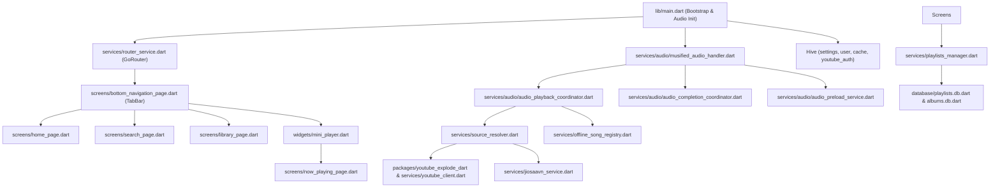

# Musified Architecture & File Linkage Map

> Comprehensive dependency graph, caller/callee matrix, and linkage map of all 127 Dart source files in `lib/` (excluding auto-generated localization files).

## Table of Contents

- [1. Entry Point & Routing](#1-entry-point--routing)
- [2. Audio Subsystem (Playback Engine)](#2-audio-subsystem-playback-engine)
- [3. Services & Data Layer](#3-services--data-layer)
- [4. Database & Storage](#4-database--storage)
- [5. Screens (UI Views)](#5-screens-ui-views)
- [6. Widgets & UI Components](#6-widgets--ui-components)
- [7. Utilities & Helpers](#7-utilities--helpers)
- [8. Theme & Styling](#8-theme--styling)
- [9. Models & State Objects](#9-models--state-objects)
- [10. Extensions & Constants](#10-extensions--constants)
- [Summary of Orphaned & Dead Files](#summary-of-orphaned--dead-files)
- [Circular Dependency Graph & Hotspots](#circular-dependency-graph--hotspots)
- [Hive Box Persistence Map](#hive-box-persistence-map)
- [Route Hierarchy & Screen Map](#route-hierarchy--screen-map)

## High-Level Architecture Diagram

## 1. Entry Point & Routing

### `lib/main.dart`

- **Lines of Code**: 467
- **Defined Types/Classes**: `MusifiedApp, _MusifiedAppState`
- **Key Functions/Globals**: `Icon, MusifiedApp, SizedBox, Text, _onOfflineModeChanged, _onThemeChanged, _showPlaylistError, appLinks`
- **Re-exports**: `lib/services/logger_service.dart`
- **Inbound Links (Imported By - 39 files)**:
  - [`lib/screens/artist_page.dart`](#libscreensartist_pagedart)
  - [`lib/screens/bottom_navigation_page.dart`](#libscreensbottom_navigation_pagedart)
  - [`lib/screens/home_page.dart`](#libscreenshome_pagedart)
  - [`lib/screens/logs_page.dart`](#libscreenslogs_pagedart)
  - [`lib/screens/now_playing_page.dart`](#libscreensnow_playing_pagedart)
  - [`lib/screens/playlist_page.dart`](#libscreensplaylist_pagedart)
  - [`lib/screens/search_page.dart`](#libscreenssearch_pagedart)
  - [`lib/screens/settings_page.dart`](#libscreenssettings_pagedart)
  - [`lib/screens/user_songs_page.dart`](#libscreensuser_songs_pagedart)
  - [`lib/screens/youtube_auth_webview.dart`](#libscreensyoutube_auth_webviewdart)
  - [`lib/services/artist_service.dart`](#libservicesartist_servicedart)
  - [`lib/services/audio/audio_completion_coordinator.dart`](#libservicesaudioaudio_completion_coordinatordart)
  - [`lib/services/audio/audio_playback_coordinator.dart`](#libservicesaudioaudio_playback_coordinatordart)
  - [`lib/services/audio/audio_playback_install.dart`](#libservicesaudioaudio_playback_installdart)
  - [`lib/services/audio/audio_preload_service.dart`](#libservicesaudioaudio_preload_servicedart)
  - [`lib/services/audio/musified_audio_handler.dart`](#libservicesaudiomusified_audio_handlerdart)
  - [`lib/services/common_services.dart`](#libservicescommon_servicesdart)
  - [`lib/services/data_manager.dart`](#libservicesdata_managerdart)
  - [`lib/services/jiosaavn_service.dart`](#libservicesjiosaavn_servicedart)
  - [`lib/services/playlist_download_service.dart`](#libservicesplaylist_download_servicedart)
  - [`lib/services/playlist_sharing.dart`](#libservicesplaylist_sharingdart)
  - [`lib/services/playlists_manager.dart`](#libservicesplaylists_managerdart)
  - [`lib/services/source_resolver.dart`](#libservicessource_resolverdart)
  - [`lib/services/youtube_auth_service.dart`](#libservicesyoutube_auth_servicedart)
  - [`lib/services/youtube_music_sync_service.dart`](#libservicesyoutube_music_sync_servicedart)
  - [`lib/utilities/async_loader.dart`](#libutilitiesasync_loaderdart)
  - [`lib/utilities/flutter_toast.dart`](#libutilitiesflutter_toastdart)
  - [`lib/widgets/mini_player.dart`](#libwidgetsmini_playerdart)
  - [`lib/widgets/now_playing/bottom_actions_row.dart`](#libwidgetsnow_playingbottom_actions_rowdart)
  - [`lib/widgets/now_playing/now_playing_artwork.dart`](#libwidgetsnow_playingnow_playing_artworkdart)
  - [`lib/widgets/now_playing/now_playing_controls.dart`](#libwidgetsnow_playingnow_playing_controlsdart)
  - [`lib/widgets/now_playing/source_picker_sheet.dart`](#libwidgetsnow_playingsource_picker_sheetdart)
  - [`lib/widgets/now_playing/synced_lyrics_view.dart`](#libwidgetsnow_playingsynced_lyrics_viewdart)
  - [`lib/widgets/playback_icon_button.dart`](#libwidgetsplayback_icon_buttondart)
  - [`lib/widgets/playlist_page/shuffle_play_button.dart`](#libwidgetsplaylist_pageshuffle_play_buttondart)
  - [`lib/widgets/position_slider.dart`](#libwidgetsposition_sliderdart)
  - [`lib/widgets/queue_list_view.dart`](#libwidgetsqueue_list_viewdart)
  - [`lib/widgets/song_actions_sheet.dart`](#libwidgetssong_actions_sheetdart)
  - [`lib/widgets/song_tile.dart`](#libwidgetssong_tiledart)
- **Outbound Links (Imports - 21 internal files)**:
  - [`lib/extensions/l10n.dart`](#libextensionsl10ndart)
  - [`lib/localization/app_localizations.dart`](#liblocalizationapp_localizationsdart)
  - [`lib/services/audio_service.dart`](#libservicesaudio_servicedart)
  - [`lib/services/common_services.dart`](#libservicescommon_servicesdart)
  - [`lib/services/data_manager.dart`](#libservicesdata_managerdart)
  - [`lib/services/io_service.dart`](#libservicesio_servicedart)
  - [`lib/services/logger_service.dart`](#libserviceslogger_servicedart)
  - [`lib/services/playlist_download_service.dart`](#libservicesplaylist_download_servicedart)
  - [`lib/services/playlist_sharing.dart`](#libservicesplaylist_sharingdart)
  - [`lib/services/playlists_manager.dart`](#libservicesplaylists_managerdart)
  - [`lib/services/router_service.dart`](#libservicesrouter_servicedart)
  - [`lib/services/settings_manager.dart`](#libservicessettings_managerdart)
  - [`lib/services/source_resolver.dart`](#libservicessource_resolverdart)
  - [`lib/services/youtube_auth_service.dart`](#libservicesyoutube_auth_servicedart)
  - [`lib/services/youtube_music_sync_service.dart`](#libservicesyoutube_music_sync_servicedart)
  - [`lib/services/ytdlp_client_sync_service.dart`](#libservicesytdlp_client_sync_servicedart)
  - [`lib/theme/app_themes.dart`](#libthemeapp_themesdart)
  - [`lib/theme/musified_style.dart`](#libthememusified_styledart)
  - [`lib/utilities/flutter_toast.dart`](#libutilitiesflutter_toastdart)
  - [`lib/utilities/language_utils.dart`](#libutilitieslanguage_utilsdart)
  - [`lib/utilities/playlist_utils.dart`](#libutilitiesplaylist_utilsdart)

### `lib/services/router_service.dart`

- **Lines of Code**: 378
- **Defined Types/Classes**: `NavigationManager`
- **Key Functions/Globals**: `_, _albumRoute, _artistRoute, _getRouteBranches, _setupRouter, artistId, ctx, currentPath`
- **Inbound Links (Imported By - 8 files)**:
  - [`lib/main.dart`](#libmaindart)
  - [`lib/screens/artist_page.dart`](#libscreensartist_pagedart)
  - [`lib/screens/bottom_navigation_page.dart`](#libscreensbottom_navigation_pagedart)
  - [`lib/screens/library_page.dart`](#libscreenslibrary_pagedart)
  - [`lib/screens/search_page.dart`](#libscreenssearch_pagedart)
  - [`lib/utilities/flutter_toast.dart`](#libutilitiesflutter_toastdart)
  - [`lib/widgets/now_playing/now_playing_controls.dart`](#libwidgetsnow_playingnow_playing_controlsdart)
  - [`lib/widgets/playlist_bar.dart`](#libwidgetsplaylist_bardart)
- **Outbound Links (Imports - 13 internal files)**:
  - [`lib/screens/artist_page.dart`](#libscreensartist_pagedart)
  - [`lib/screens/bottom_navigation_page.dart`](#libscreensbottom_navigation_pagedart)
  - [`lib/screens/home_page.dart`](#libscreenshome_pagedart)
  - [`lib/screens/library_page.dart`](#libscreenslibrary_pagedart)
  - [`lib/screens/logs_page.dart`](#libscreenslogs_pagedart)
  - [`lib/screens/playlist_folder_page.dart`](#libscreensplaylist_folder_pagedart)
  - [`lib/screens/playlist_page.dart`](#libscreensplaylist_pagedart)
  - [`lib/screens/search_page.dart`](#libscreenssearch_pagedart)
  - [`lib/screens/settings_page.dart`](#libscreenssettings_pagedart)
  - [`lib/screens/user_songs_page.dart`](#libscreensuser_songs_pagedart)
  - [`lib/services/playlist_download_service.dart`](#libservicesplaylist_download_servicedart)
  - [`lib/services/settings_manager.dart`](#libservicessettings_managerdart)
  - [`lib/widgets/offline_search_placeholder.dart`](#libwidgetsoffline_search_placeholderdart)

## 2. Audio Subsystem (Playback Engine)

### `lib/services/audio/audio.dart`

- **Lines of Code**: 14
- **Inbound Links (Imported By - 0 files)**:
  - **⚠️ NONE (Orphaned / Unused File)**
- **Outbound Links (Imports - 0 internal files)**:
  - *None (Leaf node)*

### `lib/services/audio/audio_browse_catalog.dart`

- **Lines of Code**: 182
- **Key Functions/Globals**: `MediaItem, activeYtid, artist, fromLibraries, fromQueue, normalised, song, ytid`
- **Inbound Links (Imported By - 1 files)**:
  - [`lib/services/audio/musified_audio_handler.dart`](#libservicesaudiomusified_audio_handlerdart)
- **Outbound Links (Imports - 3 internal files)**:
  - [`lib/utilities/app_utils.dart`](#libutilitiesapp_utilsdart)
  - [`lib/utilities/map_utils.dart`](#libutilitiesmap_utilsdart)
  - [`lib/utilities/mediaitem.dart`](#libutilitiesmediaitemdart)

### `lib/services/audio/audio_completion_coordinator.dart`

- **Lines of Code**: 411
- **Defined Types/Classes**: `AudioCompletionCoordinator, NearEndSkipContext, PlaybackErrorContext, ProcessingCompletedContext, SongCompletionContext`
- **Key Functions/Globals**: `NearEndSkipContext, PlaybackErrorContext, ProcessingCompletedContext, SongCompletionContext, advance, catalog, clearConsecutiveErrors, completeSong`
- **Inbound Links (Imported By - 1 files)**:
  - [`lib/services/audio/musified_audio_handler.dart`](#libservicesaudiomusified_audio_handlerdart)
- **Outbound Links (Imports - 1 internal files)**:
  - [`lib/main.dart`](#libmaindart)

### `lib/services/audio/audio_handler_hub.dart`

- **Lines of Code**: 52
- **Defined Types/Classes**: `AudioHandlerHub`
- **Key Functions/Globals**: `activeQueueYtids, cleanupStalePreloads, resetPreloads, upcomingPreloadCandidates`
- **Inbound Links (Imported By - 1 files)**:
  - [`lib/services/audio/musified_audio_handler.dart`](#libservicesaudiomusified_audio_handlerdart)
- **Outbound Links (Imports - 4 internal files)**:
  - [`lib/services/audio/audio_preload_cache.dart`](#libservicesaudioaudio_preload_cachedart)
  - [`lib/services/audio/audio_preload_service.dart`](#libservicesaudioaudio_preload_servicedart)
  - [`lib/services/audio/audio_queue_controller.dart`](#libservicesaudioaudio_queue_controllerdart)
  - [`lib/services/audio/audio_queue_state.dart`](#libservicesaudioaudio_queue_statedart)

### `lib/services/audio/audio_playback_coordinator.dart`

- **Lines of Code**: 756
- **Defined Types/Classes**: `AudioPlaybackCoordinator, GaplessInstallContext`
- **Key Functions/Globals**: `Function, GaplessInstallContext, _recoverPlayerAfterLoadFailure, _setAudioSourceAndPlay, allowOnlineRetry, atNaturalEnd, attemptOfflineFallback, audioPath`
- **Inbound Links (Imported By - 1 files)**:
  - [`lib/services/audio/musified_audio_handler.dart`](#libservicesaudiomusified_audio_handlerdart)
- **Outbound Links (Imports - 6 internal files)**:
  - [`lib/main.dart`](#libmaindart)
  - [`lib/services/audio/audio_playback_install.dart`](#libservicesaudioaudio_playback_installdart)
  - [`lib/services/audio/playback_source.dart`](#libservicesaudioplayback_sourcedart)
  - [`lib/services/common_services.dart`](#libservicescommon_servicesdart)
  - [`lib/utilities/app_utils.dart`](#libutilitiesapp_utilsdart)
  - [`lib/utilities/async_operation_queue.dart`](#libutilitiesasync_operation_queuedart)

### `lib/services/audio/audio_playback_install.dart`

- **Lines of Code**: 125
- **Defined Types/Classes**: `AudioPlaybackInstall`
- **Key Functions/Globals**: `bytes, catalogDuration, catalogUri, codec, embedded, file, fileSource, inner`
- **Inbound Links (Imported By - 2 files)**:
  - [`lib/services/audio/audio_playback_coordinator.dart`](#libservicesaudioaudio_playback_coordinatordart)
  - [`lib/services/audio/musified_audio_handler.dart`](#libservicesaudiomusified_audio_handlerdart)
- **Outbound Links (Imports - 4 internal files)**:
  - [`lib/main.dart`](#libmaindart)
  - [`lib/services/common_services.dart`](#libservicescommon_servicesdart)
  - [`lib/utilities/app_utils.dart`](#libutilitiesapp_utilsdart)
  - [`lib/utilities/mediaitem.dart`](#libutilitiesmediaitemdart)

### `lib/services/audio/audio_preload_cache.dart`

- **Lines of Code**: 30
- **Defined Types/Classes**: `AudioPreloadCache`
- **Key Functions/Globals**: `activeCount, drop, oldest, reset, trimIfNeeded`
- **Inbound Links (Imported By - 2 files)**:
  - [`lib/services/audio/audio_handler_hub.dart`](#libservicesaudioaudio_handler_hubdart)
  - [`lib/services/audio/audio_preload_service.dart`](#libservicesaudioaudio_preload_servicedart)
- **Outbound Links (Imports - 0 internal files)**:
  - *None (Leaf node)*

### `lib/services/audio/audio_preload_service.dart`

- **Lines of Code**: 211
- **Defined Types/Classes**: `AudioPreloadService`
- **Key Functions/Globals**: `cached, cleanupStaleForYtids, nextIndex, nextSong, preloadSequentially, preloadSingle, queueYtids, resolveNextStreamUrl`
- **Inbound Links (Imported By - 1 files)**:
  - [`lib/services/audio/audio_handler_hub.dart`](#libservicesaudioaudio_handler_hubdart)
- **Outbound Links (Imports - 4 internal files)**:
  - [`lib/main.dart`](#libmaindart)
  - [`lib/services/audio/audio_preload_cache.dart`](#libservicesaudioaudio_preload_cachedart)
  - [`lib/services/common_services.dart`](#libservicescommon_servicesdart)
  - [`lib/utilities/app_utils.dart`](#libutilitiesapp_utilsdart)

### `lib/services/audio/audio_queue_controller.dart`

- **Lines of Code**: 161
- **Defined Types/Classes**: `AudioQueueController`
- **Key Functions/Globals**: `adjustIndicesAfterRemove, adjustIndicesAfterReorder, autoPickedEntry, clearKeepingCurrent, entry, index, insertIndex, insertIndexForAdd`
- **Inbound Links (Imported By - 2 files)**:
  - [`lib/services/audio/audio_handler_hub.dart`](#libservicesaudioaudio_handler_hubdart)
  - [`lib/services/audio/musified_audio_handler.dart`](#libservicesaudiomusified_audio_handlerdart)
- **Outbound Links (Imports - 2 internal files)**:
  - [`lib/services/audio/audio_queue_state.dart`](#libservicesaudioaudio_queue_statedart)
  - [`lib/utilities/map_utils.dart`](#libutilitiesmap_utilsdart)

### `lib/services/audio/audio_queue_state.dart`

- **Lines of Code**: 57
- **Defined Types/Classes**: `AudioQueueState`
- **Key Functions/Globals**: `_loadingIndex, addToHistory, containsIndex, currentIndex, entryId, markLoading, resetIndices, ytid`
- **Inbound Links (Imported By - 3 files)**:
  - [`lib/services/audio/audio_handler_hub.dart`](#libservicesaudioaudio_handler_hubdart)
  - [`lib/services/audio/audio_queue_controller.dart`](#libservicesaudioaudio_queue_controllerdart)
  - [`lib/services/audio/musified_audio_handler.dart`](#libservicesaudiomusified_audio_handlerdart)
- **Outbound Links (Imports - 1 internal files)**:
  - [`lib/utilities/queue_entry_utils.dart`](#libutilitiesqueue_entry_utilsdart)

### `lib/services/audio/latest_queue_navigator.dart`

- **Lines of Code**: 60
- **Defined Types/Classes**: `LatestQueueNavigator`
- **Key Functions/Globals**: `_revision, _run, _wake, cancel, changed, index, revision, select`
- **Inbound Links (Imported By - 1 files)**:
  - [`lib/services/audio/musified_audio_handler.dart`](#libservicesaudiomusified_audio_handlerdart)
- **Outbound Links (Imports - 0 internal files)**:
  - *None (Leaf node)*

### `lib/services/audio/musified_audio_handler.dart`

- **Lines of Code**: 2932
- **Defined Types/Classes**: `MusifiedAudioHandler`
- **Key Functions/Globals**: `Duration, _addToHistory, _armStallWatch, _backgroundAddSongsToQueue, _buildIdMap, _buildQueueMediaItems, _canonicalPlaybackDuration, _cleanupOldPreloadedSongs`
- **Inbound Links (Imported By - 0 files)**:
  - **⚠️ NONE (Orphaned / Unused File)**
- **Outbound Links (Imports - 17 internal files)**:
  - [`lib/main.dart`](#libmaindart)
  - [`lib/models/full_player_state.dart`](#libmodelsfull_player_statedart)
  - [`lib/models/position_data.dart`](#libmodelsposition_datadart)
  - [`lib/services/audio/audio_browse_catalog.dart`](#libservicesaudioaudio_browse_catalogdart)
  - [`lib/services/audio/audio_completion_coordinator.dart`](#libservicesaudioaudio_completion_coordinatordart)
  - [`lib/services/audio/audio_handler_hub.dart`](#libservicesaudioaudio_handler_hubdart)
  - [`lib/services/audio/audio_playback_coordinator.dart`](#libservicesaudioaudio_playback_coordinatordart)
  - [`lib/services/audio/audio_playback_install.dart`](#libservicesaudioaudio_playback_installdart)
  - [`lib/services/audio/audio_queue_controller.dart`](#libservicesaudioaudio_queue_controllerdart)
  - [`lib/services/audio/audio_queue_state.dart`](#libservicesaudioaudio_queue_statedart)
  - [`lib/services/audio/latest_queue_navigator.dart`](#libservicesaudiolatest_queue_navigatordart)
  - [`lib/services/common_services.dart`](#libservicescommon_servicesdart)
  - [`lib/services/settings_manager.dart`](#libservicessettings_managerdart)
  - [`lib/utilities/app_utils.dart`](#libutilitiesapp_utilsdart)
  - [`lib/utilities/flutter_toast.dart`](#libutilitiesflutter_toastdart)
  - [`lib/utilities/map_utils.dart`](#libutilitiesmap_utilsdart)
  - [`lib/utilities/mediaitem.dart`](#libutilitiesmediaitemdart)

### `lib/services/audio/playback_source.dart`

- **Lines of Code**: 7
- **Defined Types/Classes**: `PlaybackSource`
- **Key Functions/Globals**: `PlaybackSource`
- **Inbound Links (Imported By - 1 files)**:
  - [`lib/services/audio/audio_playback_coordinator.dart`](#libservicesaudioaudio_playback_coordinatordart)
- **Outbound Links (Imports - 0 internal files)**:
  - *None (Leaf node)*

### `lib/services/audio_service.dart`

- **Lines of Code**: 1
- **Inbound Links (Imported By - 1 files)**:
  - [`lib/main.dart`](#libmaindart)
- **Outbound Links (Imports - 0 internal files)**:
  - *None (Leaf node)*

## 3. Services & Data Layer

### `lib/services/artist_service.dart`

- **Lines of Code**: 983
- **Key Functions/Globals**: `Function, _addAlias, _artistCatalogCacheKey, _artistChannelCacheKey, _artistMapFromMusicArtist, _artistNameFromVideoTitle, _artistProfileCacheKey, _artistSearchAliases`
- **Inbound Links (Imported By - 6 files)**:
  - [`lib/screens/artist_page.dart`](#libscreensartist_pagedart)
  - [`lib/screens/playlist_page.dart`](#libscreensplaylist_pagedart)
  - [`lib/services/common_services.dart`](#libservicescommon_servicesdart)
  - [`lib/services/playlists_manager.dart`](#libservicesplaylists_managerdart)
  - [`lib/widgets/artist_bar.dart`](#libwidgetsartist_bardart)
  - [`lib/widgets/playlist_bar.dart`](#libwidgetsplaylist_bardart)
- **Outbound Links (Imports - 6 internal files)**:
  - [`lib/constants/artist_constants.dart`](#libconstantsartist_constantsdart)
  - [`lib/main.dart`](#libmaindart)
  - [`lib/services/data_manager.dart`](#libservicesdata_managerdart)
  - [`lib/services/youtube_client.dart`](#libservicesyoutube_clientdart)
  - [`lib/utilities/app_utils.dart`](#libutilitiesapp_utilsdart)
  - [`lib/utilities/formatter.dart`](#libutilitiesformatterdart)

### `lib/services/common_services.dart`

- **Lines of Code**: 1698
- **Key Functions/Globals**: `Function, _cacheResolvedStream, _cacheSaavnMatchInBackground, _cacheSelectedAudioStream, _deduplicateLikedSongs, _downloadAndSaveArtworkFile, _getCachedSongUrl, _isCachedHeAacYoutube`
- **Inbound Links (Imported By - 23 files)**:
  - [`lib/main.dart`](#libmaindart)
  - [`lib/screens/home_page.dart`](#libscreenshome_pagedart)
  - [`lib/screens/library_page.dart`](#libscreenslibrary_pagedart)
  - [`lib/screens/search_page.dart`](#libscreenssearch_pagedart)
  - [`lib/screens/settings_page.dart`](#libscreenssettings_pagedart)
  - [`lib/screens/user_songs_page.dart`](#libscreensuser_songs_pagedart)
  - [`lib/services/audio/audio_playback_coordinator.dart`](#libservicesaudioaudio_playback_coordinatordart)
  - [`lib/services/audio/audio_playback_install.dart`](#libservicesaudioaudio_playback_installdart)
  - [`lib/services/audio/audio_preload_service.dart`](#libservicesaudioaudio_preload_servicedart)
  - [`lib/services/audio/musified_audio_handler.dart`](#libservicesaudiomusified_audio_handlerdart)
  - [`lib/services/playlist_download_service.dart`](#libservicesplaylist_download_servicedart)
  - [`lib/services/youtube_music_sync_service.dart`](#libservicesyoutube_music_sync_servicedart)
  - [`lib/utilities/mediaitem.dart`](#libutilitiesmediaitemdart)
  - [`lib/utilities/song_info_dialog.dart`](#libutilitiessong_info_dialogdart)
  - [`lib/widgets/now_playing/bottom_actions_row.dart`](#libwidgetsnow_playingbottom_actions_rowdart)
  - [`lib/widgets/now_playing/full_page_lyrics_modal.dart`](#libwidgetsnow_playingfull_page_lyrics_modaldart)
  - [`lib/widgets/now_playing/now_playing_artwork.dart`](#libwidgetsnow_playingnow_playing_artworkdart)
  - [`lib/widgets/now_playing/now_playing_controls.dart`](#libwidgetsnow_playingnow_playing_controlsdart)
  - [`lib/widgets/now_playing/source_picker_sheet.dart`](#libwidgetsnow_playingsource_picker_sheetdart)
  - [`lib/widgets/playlist_bar.dart`](#libwidgetsplaylist_bardart)
  - [`lib/widgets/playlist_page/download_button.dart`](#libwidgetsplaylist_pagedownload_buttondart)
  - [`lib/widgets/playlist_page/like_button.dart`](#libwidgetsplaylist_pagelike_buttondart)
  - [`lib/widgets/song_actions_sheet.dart`](#libwidgetssong_actions_sheetdart)
- **Outbound Links (Imports - 19 internal files)**:
  - [`lib/constants/clients.dart`](#libconstantsclientsdart)
  - [`lib/main.dart`](#libmaindart)
  - [`lib/services/artist_service.dart`](#libservicesartist_servicedart)
  - [`lib/services/data_manager.dart`](#libservicesdata_managerdart)
  - [`lib/services/download_transfer.dart`](#libservicesdownload_transferdart)
  - [`lib/services/io_service.dart`](#libservicesio_servicedart)
  - [`lib/services/lyrics_manager.dart`](#libserviceslyrics_managerdart)
  - [`lib/services/offline_song_registry.dart`](#libservicesoffline_song_registrydart)
  - [`lib/services/playlists_manager.dart`](#libservicesplaylists_managerdart)
  - [`lib/services/settings_manager.dart`](#libservicessettings_managerdart)
  - [`lib/services/source_resolver.dart`](#libservicessource_resolverdart)
  - [`lib/services/youtube_auth_service.dart`](#libservicesyoutube_auth_servicedart)
  - [`lib/services/youtube_client.dart`](#libservicesyoutube_clientdart)
  - [`lib/services/youtube_music_sync_service.dart`](#libservicesyoutube_music_sync_servicedart)
  - [`lib/services/ytdlp_client_sync_service.dart`](#libservicesytdlp_client_sync_servicedart)
  - [`lib/utilities/app_utils.dart`](#libutilitiesapp_utilsdart)
  - [`lib/utilities/async_operation_queue.dart`](#libutilitiesasync_operation_queuedart)
  - [`lib/utilities/formatter.dart`](#libutilitiesformatterdart)
  - [`lib/utilities/track_matcher.dart`](#libutilitiestrack_matcherdart)

### `lib/services/data_manager.dart`

- **Lines of Code**: 274
- **Defined Types/Classes**: `_CacheEntry`
- **Key Functions/Globals**: `_box, _getCacheDurationForKey, _memoryCache, _openBox, _setMemoryCacheEntry, _touchMemoryCacheEntry, _trimMemoryCacheIfNeeded, _trimSaavnMatchCache`
- **Inbound Links (Imported By - 11 files)**:
  - [`lib/main.dart`](#libmaindart)
  - [`lib/screens/playlist_page.dart`](#libscreensplaylist_pagedart)
  - [`lib/screens/search_page.dart`](#libscreenssearch_pagedart)
  - [`lib/screens/settings_page.dart`](#libscreenssettings_pagedart)
  - [`lib/screens/user_songs_page.dart`](#libscreensuser_songs_pagedart)
  - [`lib/services/artist_service.dart`](#libservicesartist_servicedart)
  - [`lib/services/common_services.dart`](#libservicescommon_servicesdart)
  - [`lib/services/playlist_download_service.dart`](#libservicesplaylist_download_servicedart)
  - [`lib/services/playlists_manager.dart`](#libservicesplaylists_managerdart)
  - [`lib/services/youtube_music_sync_service.dart`](#libservicesyoutube_music_sync_servicedart)
  - [`lib/services/ytdlp_client_sync_service.dart`](#libservicesytdlp_client_sync_servicedart)
- **Outbound Links (Imports - 2 internal files)**:
  - [`lib/main.dart`](#libmaindart)
  - [`lib/utilities/artwork_provider.dart`](#libutilitiesartwork_providerdart)

### `lib/services/device_log_upload.dart`

- **Lines of Code**: 141
- **Defined Types/Classes**: `DeviceLogUpload`
- **Key Functions/Globals**: `body, content, current, decoded, dir, file, folder, response`
- **Inbound Links (Imported By - 1 files)**:
  - [`lib/services/logger_service.dart`](#libserviceslogger_servicedart)
- **Outbound Links (Imports - 0 internal files)**:
  - *None (Leaf node)*

### `lib/services/download_transfer.dart`

- **Lines of Code**: 62
- **Defined Types/Classes**: `DownloadCancellation, DownloadCancelled`
- **Key Functions/Globals**: `cancel, check, chunk, idleTimeout, iterator, minimumBytes, received, sink`
- **Inbound Links (Imported By - 2 files)**:
  - [`lib/services/common_services.dart`](#libservicescommon_servicesdart)
  - [`lib/services/playlist_download_service.dart`](#libservicesplaylist_download_servicedart)
- **Outbound Links (Imports - 0 internal files)**:
  - *None (Leaf node)*

### `lib/services/io_service.dart`

- **Lines of Code**: 40
- **Defined Types/Classes**: `FilePaths`
- **Key Functions/Globals**: `applicationDirPath, artworksDirectory, safeId, tracksDirectory`
- **Inbound Links (Imported By - 3 files)**:
  - [`lib/main.dart`](#libmaindart)
  - [`lib/services/common_services.dart`](#libservicescommon_servicesdart)
  - [`lib/services/playlist_download_service.dart`](#libservicesplaylist_download_servicedart)
- **Outbound Links (Imports - 1 internal files)**:
  - [`lib/utilities/app_utils.dart`](#libutilitiesapp_utilsdart)

### `lib/services/jiosaavn_service.dart`

- **Lines of Code**: 273
- **Defined Types/Classes**: `JioSaavnService`
- **Key Functions/Globals**: `_decryptUrl, _formatTrack, arrStart, artist, artistMap, body, charts, cleanId`
- **Inbound Links (Imported By - 3 files)**:
  - [`lib/screens/home_page.dart`](#libscreenshome_pagedart)
  - [`lib/services/playlists_manager.dart`](#libservicesplaylists_managerdart)
  - [`lib/services/source_resolver.dart`](#libservicessource_resolverdart)
- **Outbound Links (Imports - 1 internal files)**:
  - [`lib/main.dart`](#libmaindart)

### `lib/services/logger_service.dart`

- **Lines of Code**: 81
- **Defined Types/Classes**: `Logger`
- **Key Functions/Globals**: `_logCount, clearLogs, copyLogs, dataMessage, errorMessage, getLogCount, getLogs, joined`
- **Inbound Links (Imported By - 2 files)**:
  - [`lib/main.dart`](#libmaindart)
  - [`lib/services/ytdlp_client_sync_service.dart`](#libservicesytdlp_client_sync_servicedart)
- **Outbound Links (Imports - 2 internal files)**:
  - [`lib/extensions/l10n.dart`](#libextensionsl10ndart)
  - [`lib/services/device_log_upload.dart`](#libservicesdevice_log_uploaddart)

### `lib/services/lyrics_manager.dart`

- **Lines of Code**: 231
- **Defined Types/Classes**: `LyricsManager`
- **Key Functions/Globals**: `Duration, _fetchLyricsFromLrcLib, _fetchLyricsFromLyricsOvh, _fetchLyricsFromParolesNet, _lyricsUrl, _removeSpaces, _searchLyricsFromLrcLib, addCopyright`
- **Inbound Links (Imported By - 1 files)**:
  - [`lib/services/common_services.dart`](#libservicescommon_servicesdart)
- **Outbound Links (Imports - 0 internal files)**:
  - *None (Leaf node)*

### `lib/services/offline_song_registry.dart`

- **Lines of Code**: 34
- **Defined Types/Classes**: `OfflineSongRegistry`
- **Key Functions/Globals**: `_updates, index, remove, songs, upsert`
- **Inbound Links (Imported By - 1 files)**:
  - [`lib/services/common_services.dart`](#libservicescommon_servicesdart)
- **Outbound Links (Imports - 1 internal files)**:
  - [`lib/utilities/async_operation_queue.dart`](#libutilitiesasync_operation_queuedart)

### `lib/services/playlist_download_service.dart`

- **Lines of Code**: 629
- **Defined Types/Classes**: `DownloadProgress, OfflinePlaylistService`
- **Key Functions/Globals**: `_getSongIdsUsedElsewhere, _handleDownloadCompletion, _processDownloadQueue, _resyncOfflinePlaylistFlags, activeIds, artworksDir, batchQuality, batchSource`
- **Inbound Links (Imported By - 9 files)**:
  - [`lib/main.dart`](#libmaindart)
  - [`lib/screens/library_page.dart`](#libscreenslibrary_pagedart)
  - [`lib/screens/playlist_page.dart`](#libscreensplaylist_pagedart)
  - [`lib/services/playlists_manager.dart`](#libservicesplaylists_managerdart)
  - [`lib/services/router_service.dart`](#libservicesrouter_servicedart)
  - [`lib/utilities/offline_playlist_dialogs.dart`](#libutilitiesoffline_playlist_dialogsdart)
  - [`lib/utilities/playlist_utils.dart`](#libutilitiesplaylist_utilsdart)
  - [`lib/widgets/now_playing/bottom_actions_row.dart`](#libwidgetsnow_playingbottom_actions_rowdart)
  - [`lib/widgets/playlist_page/download_button.dart`](#libwidgetsplaylist_pagedownload_buttondart)
- **Outbound Links (Imports - 9 internal files)**:
  - [`lib/extensions/l10n.dart`](#libextensionsl10ndart)
  - [`lib/main.dart`](#libmaindart)
  - [`lib/services/common_services.dart`](#libservicescommon_servicesdart)
  - [`lib/services/data_manager.dart`](#libservicesdata_managerdart)
  - [`lib/services/download_transfer.dart`](#libservicesdownload_transferdart)
  - [`lib/services/io_service.dart`](#libservicesio_servicedart)
  - [`lib/services/playlists_manager.dart`](#libservicesplaylists_managerdart)
  - [`lib/services/settings_manager.dart`](#libservicessettings_managerdart)
  - [`lib/utilities/flutter_toast.dart`](#libutilitiesflutter_toastdart)

### `lib/services/playlist_sharing.dart`

- **Lines of Code**: 93
- **Defined Types/Classes**: `PlaylistSharingService`
- **Key Functions/Globals**: `Function, compactPlaylist, concurrency, expandedSongs, index, jsonString, nextIndex, results`
- **Inbound Links (Imported By - 2 files)**:
  - [`lib/main.dart`](#libmaindart)
  - [`lib/screens/playlist_page.dart`](#libscreensplaylist_pagedart)
- **Outbound Links (Imports - 4 internal files)**:
  - [`lib/main.dart`](#libmaindart)
  - [`lib/services/youtube_client.dart`](#libservicesyoutube_clientdart)
  - [`lib/utilities/app_utils.dart`](#libutilitiesapp_utilsdart)
  - [`lib/utilities/formatter.dart`](#libutilitiesformatterdart)

### `lib/services/playlists_manager.dart`

- **Lines of Code**: 1627
- **Key Functions/Globals**: `_deduplicateLikedPlaylists, _fetchYouTubePlaylist, _latestPlaylistLikeUpdateTokens, _likedPlaylistIdsAreEqual, _loadSongsForPlaylist, _maxOnlinePlaylistsCache, _playlistLikeUpdateToken, _removePlaylistFromFolders`
- **Inbound Links (Imported By - 12 files)**:
  - [`lib/main.dart`](#libmaindart)
  - [`lib/screens/artist_page.dart`](#libscreensartist_pagedart)
  - [`lib/screens/home_page.dart`](#libscreenshome_pagedart)
  - [`lib/screens/library_page.dart`](#libscreenslibrary_pagedart)
  - [`lib/screens/playlist_folder_page.dart`](#libscreensplaylist_folder_pagedart)
  - [`lib/screens/playlist_page.dart`](#libscreensplaylist_pagedart)
  - [`lib/screens/search_page.dart`](#libscreenssearch_pagedart)
  - [`lib/services/common_services.dart`](#libservicescommon_servicesdart)
  - [`lib/services/playlist_download_service.dart`](#libservicesplaylist_download_servicedart)
  - [`lib/utilities/playlist_dialogs.dart`](#libutilitiesplaylist_dialogsdart)
  - [`lib/widgets/playlist_bar.dart`](#libwidgetsplaylist_bardart)
  - [`lib/widgets/playlist_page/like_button.dart`](#libwidgetsplaylist_pagelike_buttondart)
- **Outbound Links (Imports - 15 internal files)**:
  - [`lib/database/albums.db.dart`](#libdatabasealbumsdbdart)
  - [`lib/database/playlists.db.dart`](#libdatabaseplaylistsdbdart)
  - [`lib/extensions/l10n.dart`](#libextensionsl10ndart)
  - [`lib/main.dart`](#libmaindart)
  - [`lib/services/artist_service.dart`](#libservicesartist_servicedart)
  - [`lib/services/data_manager.dart`](#libservicesdata_managerdart)
  - [`lib/services/jiosaavn_service.dart`](#libservicesjiosaavn_servicedart)
  - [`lib/services/playlist_download_service.dart`](#libservicesplaylist_download_servicedart)
  - [`lib/services/settings_manager.dart`](#libservicessettings_managerdart)
  - [`lib/services/youtube_client.dart`](#libservicesyoutube_clientdart)
  - [`lib/services/youtube_music_sync_service.dart`](#libservicesyoutube_music_sync_servicedart)
  - [`lib/utilities/app_utils.dart`](#libutilitiesapp_utilsdart)
  - [`lib/utilities/flutter_toast.dart`](#libutilitiesflutter_toastdart)
  - [`lib/utilities/formatter.dart`](#libutilitiesformatterdart)
  - [`lib/utilities/playlist_utils.dart`](#libutilitiesplaylist_utilsdart)

### `lib/services/settings_manager.dart`

- **Lines of Code**: 216
- **Key Functions/Globals**: `announcementURL, audioQualitySetting, downloadQuality, downloadSource, externalRecommendations, jiosaavnEnabled, jiosaavnQuality, languageSetting`
- **Inbound Links (Imported By - 24 files)**:
  - [`lib/main.dart`](#libmaindart)
  - [`lib/screens/artist_page.dart`](#libscreensartist_pagedart)
  - [`lib/screens/bottom_navigation_page.dart`](#libscreensbottom_navigation_pagedart)
  - [`lib/screens/home_page.dart`](#libscreenshome_pagedart)
  - [`lib/screens/library_page.dart`](#libscreenslibrary_pagedart)
  - [`lib/screens/playlist_folder_page.dart`](#libscreensplaylist_folder_pagedart)
  - [`lib/screens/playlist_page.dart`](#libscreensplaylist_pagedart)
  - [`lib/screens/settings_page.dart`](#libscreenssettings_pagedart)
  - [`lib/screens/user_songs_page.dart`](#libscreensuser_songs_pagedart)
  - [`lib/services/audio/musified_audio_handler.dart`](#libservicesaudiomusified_audio_handlerdart)
  - [`lib/services/common_services.dart`](#libservicescommon_servicesdart)
  - [`lib/services/playlist_download_service.dart`](#libservicesplaylist_download_servicedart)
  - [`lib/services/playlists_manager.dart`](#libservicesplaylists_managerdart)
  - [`lib/services/router_service.dart`](#libservicesrouter_servicedart)
  - [`lib/services/source_resolver.dart`](#libservicessource_resolverdart)
  - [`lib/services/youtube_music_sync_service.dart`](#libservicesyoutube_music_sync_servicedart)
  - [`lib/theme/app_themes.dart`](#libthemeapp_themesdart)
  - [`lib/utilities/app_utils.dart`](#libutilitiesapp_utilsdart)
  - [`lib/widgets/download_picker_sheet.dart`](#libwidgetsdownload_picker_sheetdart)
  - [`lib/widgets/now_playing/bottom_actions_row.dart`](#libwidgetsnow_playingbottom_actions_rowdart)
  - [`lib/widgets/now_playing/now_playing_artwork.dart`](#libwidgetsnow_playingnow_playing_artworkdart)
  - [`lib/widgets/now_playing/now_playing_controls.dart`](#libwidgetsnow_playingnow_playing_controlsdart)
  - [`lib/widgets/playlist_page/download_button.dart`](#libwidgetsplaylist_pagedownload_buttondart)
  - [`lib/widgets/song_actions_sheet.dart`](#libwidgetssong_actions_sheetdart)
- **Outbound Links (Imports - 3 internal files)**:
  - [`lib/screens/playlist_page.dart`](#libscreensplaylist_pagedart)
  - [`lib/screens/user_songs_page.dart`](#libscreensuser_songs_pagedart)
  - [`lib/utilities/language_utils.dart`](#libutilitieslanguage_utilsdart)

### `lib/services/source_resolver.dart`

- **Lines of Code**: 205
- **Defined Types/Classes**: `SourceResolver`
- **Key Functions/Globals**: `_getBox, artist, at, box, cacheMatch, cached, clearMatchCache, data`
- **Inbound Links (Imported By - 3 files)**:
  - [`lib/main.dart`](#libmaindart)
  - [`lib/services/common_services.dart`](#libservicescommon_servicesdart)
  - [`lib/widgets/download_picker_sheet.dart`](#libwidgetsdownload_picker_sheetdart)
- **Outbound Links (Imports - 4 internal files)**:
  - [`lib/main.dart`](#libmaindart)
  - [`lib/services/jiosaavn_service.dart`](#libservicesjiosaavn_servicedart)
  - [`lib/services/settings_manager.dart`](#libservicessettings_managerdart)
  - [`lib/utilities/track_matcher.dart`](#libutilitiestrack_matcherdart)

### `lib/services/youtube_auth_service.dart`

- **Lines of Code**: 191
- **Defined Types/Classes**: `YouTubeAuthService`
- **Key Functions/Globals**: `accountName, accountPhoto, actions, activeAccountHeaderRenderer, authHeader, body, box, bytes`
- **Inbound Links (Imported By - 8 files)**:
  - [`lib/main.dart`](#libmaindart)
  - [`lib/screens/home_page.dart`](#libscreenshome_pagedart)
  - [`lib/screens/library_page.dart`](#libscreenslibrary_pagedart)
  - [`lib/screens/settings_page.dart`](#libscreenssettings_pagedart)
  - [`lib/screens/youtube_auth_webview.dart`](#libscreensyoutube_auth_webviewdart)
  - [`lib/services/common_services.dart`](#libservicescommon_servicesdart)
  - [`lib/services/youtube_music_sync_service.dart`](#libservicesyoutube_music_sync_servicedart)
  - [`lib/utilities/playlist_dialogs.dart`](#libutilitiesplaylist_dialogsdart)
- **Outbound Links (Imports - 1 internal files)**:
  - [`lib/main.dart`](#libmaindart)

### `lib/services/youtube_client.dart`

- **Lines of Code**: 4
- **Inbound Links (Imported By - 4 files)**:
  - [`lib/services/artist_service.dart`](#libservicesartist_servicedart)
  - [`lib/services/common_services.dart`](#libservicescommon_servicesdart)
  - [`lib/services/playlist_sharing.dart`](#libservicesplaylist_sharingdart)
  - [`lib/services/playlists_manager.dart`](#libservicesplaylists_managerdart)
- **Outbound Links (Imports - 0 internal files)**:
  - *None (Leaf node)*

### `lib/services/youtube_music_sync_service.dart`

- **Lines of Code**: 856
- **Defined Types/Classes**: `YouTubeMusicSyncService`
- **Key Functions/Globals**: `_appendUniqueTracks, _applyLikedMusicCount, _generateCpn, _hydratePlaylistsFromCache, _isValidYouTubeVideoId, _normalizePlaylistIdForMutation, _patchLikedMusicPlaylistCount, _persistPlaylists`
- **Inbound Links (Imported By - 7 files)**:
  - [`lib/main.dart`](#libmaindart)
  - [`lib/screens/home_page.dart`](#libscreenshome_pagedart)
  - [`lib/screens/library_page.dart`](#libscreenslibrary_pagedart)
  - [`lib/screens/settings_page.dart`](#libscreenssettings_pagedart)
  - [`lib/services/common_services.dart`](#libservicescommon_servicesdart)
  - [`lib/services/playlists_manager.dart`](#libservicesplaylists_managerdart)
  - [`lib/utilities/playlist_dialogs.dart`](#libutilitiesplaylist_dialogsdart)
- **Outbound Links (Imports - 6 internal files)**:
  - [`lib/main.dart`](#libmaindart)
  - [`lib/services/common_services.dart`](#libservicescommon_servicesdart)
  - [`lib/services/data_manager.dart`](#libservicesdata_managerdart)
  - [`lib/services/settings_manager.dart`](#libservicessettings_managerdart)
  - [`lib/services/youtube_auth_service.dart`](#libservicesyoutube_auth_servicedart)
  - [`lib/utilities/youtube_playlist_parser.dart`](#libutilitiesyoutube_playlist_parserdart)

### `lib/services/ytdlp_client_sync_service.dart`

- **Lines of Code**: 422
- **Defined Types/Classes**: `VisionOsClientConfig, YtdlpClientSyncResult, YtdlpClientSyncService`
- **Key Functions/Globals**: `VisionOsClientConfig, _active, _clientEntryKey, _latestCommitSha, _loaded, _readableError, _syncAtKey, _syncCommitKey`
- **Inbound Links (Imported By - 4 files)**:
  - [`lib/constants/clients.dart`](#libconstantsclientsdart)
  - [`lib/main.dart`](#libmaindart)
  - [`lib/screens/settings_page.dart`](#libscreenssettings_pagedart)
  - [`lib/services/common_services.dart`](#libservicescommon_servicesdart)
- **Outbound Links (Imports - 2 internal files)**:
  - [`lib/services/data_manager.dart`](#libservicesdata_managerdart)
  - [`lib/services/logger_service.dart`](#libserviceslogger_servicedart)

## 4. Database & Storage

### `lib/database/albums.db.dart`

- **Lines of Code**: 876
- **Key Functions/Globals**: `albumsDB`
- **Inbound Links (Imported By - 1 files)**:
  - [`lib/services/playlists_manager.dart`](#libservicesplaylists_managerdart)
- **Outbound Links (Imports - 0 internal files)**:
  - *None (Leaf node)*

### `lib/database/playlists.db.dart`

- **Lines of Code**: 465
- **Inbound Links (Imported By - 1 files)**:
  - [`lib/services/playlists_manager.dart`](#libservicesplaylists_managerdart)
- **Outbound Links (Imports - 0 internal files)**:
  - *None (Leaf node)*

## 5. Screens (UI Views)

### `lib/screens/artist_page.dart`

- **Lines of Code**: 482
- **Defined Types/Classes**: `ArtistPage, _ArtistPageState`
- **Key Functions/Globals**: `ArtistPage, MiniPlayerBottomSpace, SizedBox, SliverMiniPlayerBottomSpace, _artistLoadGeneration, _buildAllSongsPage, _buildHeaderSection, _buildNotFoundPage`
- **Inbound Links (Imported By - 1 files)**:
  - [`lib/services/router_service.dart`](#libservicesrouter_servicedart)
- **Outbound Links (Imports - 24 internal files)**:
  - [`lib/constants/app_constants.dart`](#libconstantsapp_constantsdart)
  - [`lib/extensions/l10n.dart`](#libextensionsl10ndart)
  - [`lib/main.dart`](#libmaindart)
  - [`lib/screens/playlist_page.dart`](#libscreensplaylist_pagedart)
  - [`lib/services/artist_service.dart`](#libservicesartist_servicedart)
  - [`lib/services/playlists_manager.dart`](#libservicesplaylists_managerdart)
  - [`lib/services/router_service.dart`](#libservicesrouter_servicedart)
  - [`lib/services/settings_manager.dart`](#libservicessettings_managerdart)
  - [`lib/theme/app_themes.dart`](#libthemeapp_themesdart)
  - [`lib/utilities/app_utils.dart`](#libutilitiesapp_utilsdart)
  - [`lib/utilities/async_loader.dart`](#libutilitiesasync_loaderdart)
  - [`lib/utilities/flutter_toast.dart`](#libutilitiesflutter_toastdart)
  - [`lib/widgets/artist_shelf.dart`](#libwidgetsartist_shelfdart)
  - [`lib/widgets/mini_player_bottom_space.dart`](#libwidgetsmini_player_bottom_spacedart)
  - [`lib/widgets/playlist_cube.dart`](#libwidgetsplaylist_cubedart)
  - [`lib/widgets/playlist_page/add_to_playlist_button.dart`](#libwidgetsplaylist_pageadd_to_playlist_buttondart)
  - [`lib/widgets/playlist_page/download_button.dart`](#libwidgetsplaylist_pagedownload_buttondart)
  - [`lib/widgets/playlist_page/empty_playlist_state.dart`](#libwidgetsplaylist_pageempty_playlist_statedart)
  - [`lib/widgets/playlist_page/like_button.dart`](#libwidgetsplaylist_pagelike_buttondart)
  - [`lib/widgets/playlist_page/playlist_action_buttons.dart`](#libwidgetsplaylist_pageplaylist_action_buttonsdart)
  - [`lib/widgets/playlist_page/playlist_header.dart`](#libwidgetsplaylist_pageplaylist_headerdart)
  - [`lib/widgets/section_header.dart`](#libwidgetssection_headerdart)
  - [`lib/widgets/song_tile.dart`](#libwidgetssong_tiledart)
  - [`lib/widgets/spinner.dart`](#libwidgetsspinnerdart)

### `lib/screens/bottom_navigation_page.dart`

- **Lines of Code**: 230
- **Defined Types/Classes**: `BottomNavigationPage, _BottomNavigationPageState, _NavigationItem`
- **Key Functions/Globals**: `BottomNavigationPage, MiniPlayer, _NavigationItem, _getCurrentIndex, _getNavigationItems, _handleOfflineModeChange, _miniPlayerVisibilityStream, _onTabTapped`
- **Inbound Links (Imported By - 1 files)**:
  - [`lib/services/router_service.dart`](#libservicesrouter_servicedart)
- **Outbound Links (Imports - 8 internal files)**:
  - [`lib/constants/app_constants.dart`](#libconstantsapp_constantsdart)
  - [`lib/extensions/l10n.dart`](#libextensionsl10ndart)
  - [`lib/main.dart`](#libmaindart)
  - [`lib/services/router_service.dart`](#libservicesrouter_servicedart)
  - [`lib/services/settings_manager.dart`](#libservicessettings_managerdart)
  - [`lib/theme/app_themes.dart`](#libthemeapp_themesdart)
  - [`lib/utilities/flutter_bottom_sheet.dart`](#libutilitiesflutter_bottom_sheetdart)
  - [`lib/widgets/mini_player.dart`](#libwidgetsmini_playerdart)

### `lib/screens/home_page.dart`

- **Lines of Code**: 728
- **Defined Types/Classes**: `HomePage, _HomePageState, _HomeSongCard`
- **Key Functions/Globals**: `HomePage, Icon, MiniPlayerBottomSpace, SectionHeader, SizedBox, Text, _HomeSongCard, _buildEmptyStateIfNeeded`
- **Inbound Links (Imported By - 1 files)**:
  - [`lib/services/router_service.dart`](#libservicesrouter_servicedart)
- **Outbound Links (Imports - 13 internal files)**:
  - [`lib/constants/app_constants.dart`](#libconstantsapp_constantsdart)
  - [`lib/main.dart`](#libmaindart)
  - [`lib/services/common_services.dart`](#libservicescommon_servicesdart)
  - [`lib/services/jiosaavn_service.dart`](#libservicesjiosaavn_servicedart)
  - [`lib/services/playlists_manager.dart`](#libservicesplaylists_managerdart)
  - [`lib/services/settings_manager.dart`](#libservicessettings_managerdart)
  - [`lib/services/youtube_auth_service.dart`](#libservicesyoutube_auth_servicedart)
  - [`lib/services/youtube_music_sync_service.dart`](#libservicesyoutube_music_sync_servicedart)
  - [`lib/theme/app_themes.dart`](#libthemeapp_themesdart)
  - [`lib/theme/musified_style.dart`](#libthememusified_styledart)
  - [`lib/widgets/mini_player_bottom_space.dart`](#libwidgetsmini_player_bottom_spacedart)
  - [`lib/widgets/playlist_cube.dart`](#libwidgetsplaylist_cubedart)
  - [`lib/widgets/section_header.dart`](#libwidgetssection_headerdart)

### `lib/screens/library_page.dart`

- **Lines of Code**: 289
- **Defined Types/Classes**: `LibraryPage, _LibraryPageState`
- **Key Functions/Globals**: `LibraryPage, MiniPlayerBottomSpace, SectionHeader, SizedBox, _buildCustomPlaylistsSections, _buildTopLibrarySections, _buildYouTubePlaylistsSections, build`
- **Inbound Links (Imported By - 1 files)**:
  - [`lib/services/router_service.dart`](#libservicesrouter_servicedart)
- **Outbound Links (Imports - 15 internal files)**:
  - [`lib/constants/app_constants.dart`](#libconstantsapp_constantsdart)
  - [`lib/services/common_services.dart`](#libservicescommon_servicesdart)
  - [`lib/services/playlist_download_service.dart`](#libservicesplaylist_download_servicedart)
  - [`lib/services/playlists_manager.dart`](#libservicesplaylists_managerdart)
  - [`lib/services/router_service.dart`](#libservicesrouter_servicedart)
  - [`lib/services/settings_manager.dart`](#libservicessettings_managerdart)
  - [`lib/services/youtube_auth_service.dart`](#libservicesyoutube_auth_servicedart)
  - [`lib/services/youtube_music_sync_service.dart`](#libservicesyoutube_music_sync_servicedart)
  - [`lib/theme/app_themes.dart`](#libthemeapp_themesdart)
  - [`lib/theme/musified_style.dart`](#libthememusified_styledart)
  - [`lib/utilities/flutter_toast.dart`](#libutilitiesflutter_toastdart)
  - [`lib/utilities/playlist_dialogs.dart`](#libutilitiesplaylist_dialogsdart)
  - [`lib/widgets/mini_player_bottom_space.dart`](#libwidgetsmini_player_bottom_spacedart)
  - [`lib/widgets/playlist_bar.dart`](#libwidgetsplaylist_bardart)
  - [`lib/widgets/section_header.dart`](#libwidgetssection_headerdart)

### `lib/screens/logs_page.dart`

- **Lines of Code**: 81
- **Defined Types/Classes**: `LogsPage`
- **Key Functions/Globals**: `LogsPage, build, isDark, lines, logs, message, navBarColor, textStyle`
- **Inbound Links (Imported By - 1 files)**:
  - [`lib/services/router_service.dart`](#libservicesrouter_servicedart)
- **Outbound Links (Imports - 4 internal files)**:
  - [`lib/main.dart`](#libmaindart)
  - [`lib/theme/app_themes.dart`](#libthemeapp_themesdart)
  - [`lib/theme/musified_style.dart`](#libthememusified_styledart)
  - [`lib/utilities/flutter_toast.dart`](#libutilitiesflutter_toastdart)

### `lib/screens/now_playing_page.dart`

- **Lines of Code**: 276
- **Defined Types/Classes**: `NowPlayingPage, _DesktopLayout, _Grabber, _MobileLayout, _NowPlayingPageState`
- **Key Functions/Globals**: `Expanded, NowPlayingPage, SizedBox, _DesktopLayout, _Grabber, _MobileLayout, _buildLandscapeLayout, _buildPortraitLayout`
- **Inbound Links (Imported By - 1 files)**:
  - [`lib/widgets/mini_player.dart`](#libwidgetsmini_playerdart)
- **Outbound Links (Imports - 7 internal files)**:
  - [`lib/main.dart`](#libmaindart)
  - [`lib/theme/app_themes.dart`](#libthemeapp_themesdart)
  - [`lib/widgets/flip_card.dart`](#libwidgetsflip_carddart)
  - [`lib/widgets/now_playing/bottom_actions_row.dart`](#libwidgetsnow_playingbottom_actions_rowdart)
  - [`lib/widgets/now_playing/now_playing_artwork.dart`](#libwidgetsnow_playingnow_playing_artworkdart)
  - [`lib/widgets/now_playing/now_playing_controls.dart`](#libwidgetsnow_playingnow_playing_controlsdart)
  - [`lib/widgets/queue_list_view.dart`](#libwidgetsqueue_list_viewdart)

### `lib/screens/playlist_folder_page.dart`

- **Lines of Code**: 315
- **Defined Types/Classes**: `PlaylistFolderPage, _PlaylistFolderPageState`
- **Key Functions/Globals**: `PlaylistFolderPage, SizedBox, SliverFillRemaining, SliverMiniPlayerBottomSpace, _showAddPlaylistDialog, _showDeleteFolderDialog, _showFolderActions, _showRemovePlaylistDialog`
- **Inbound Links (Imported By - 1 files)**:
  - [`lib/services/router_service.dart`](#libservicesrouter_servicedart)
- **Outbound Links (Imports - 13 internal files)**:
  - [`lib/constants/app_constants.dart`](#libconstantsapp_constantsdart)
  - [`lib/extensions/l10n.dart`](#libextensionsl10ndart)
  - [`lib/services/playlists_manager.dart`](#libservicesplaylists_managerdart)
  - [`lib/services/settings_manager.dart`](#libservicessettings_managerdart)
  - [`lib/theme/app_themes.dart`](#libthemeapp_themesdart)
  - [`lib/theme/musified_style.dart`](#libthememusified_styledart)
  - [`lib/utilities/app_utils.dart`](#libutilitiesapp_utilsdart)
  - [`lib/utilities/flutter_toast.dart`](#libutilitiesflutter_toastdart)
  - [`lib/utilities/musified_picker_sheet.dart`](#libutilitiesmusified_picker_sheetdart)
  - [`lib/utilities/playlist_utils.dart`](#libutilitiesplaylist_utilsdart)
  - [`lib/widgets/confirmation_dialog.dart`](#libwidgetsconfirmation_dialogdart)
  - [`lib/widgets/mini_player_bottom_space.dart`](#libwidgetsmini_player_bottom_spacedart)
  - [`lib/widgets/playlist_bar.dart`](#libwidgetsplaylist_bardart)

### `lib/screens/playlist_page.dart`

- **Lines of Code**: 690
- **Defined Types/Classes**: `PlaylistPage, PlaylistSortType, _PlaylistPageState`
- **Key Functions/Globals**: `Icon, PlaylistPage, SizedBox, SliverMiniPlayerBottomSpace, _buildDownloadButton, _buildEditButton, _buildHeaderSection, _buildPlaylistImage`
- **Inbound Links (Imported By - 3 files)**:
  - [`lib/screens/artist_page.dart`](#libscreensartist_pagedart)
  - [`lib/services/router_service.dart`](#libservicesrouter_servicedart)
  - [`lib/services/settings_manager.dart`](#libservicessettings_managerdart)
- **Outbound Links (Imports - 26 internal files)**:
  - [`lib/constants/app_constants.dart`](#libconstantsapp_constantsdart)
  - [`lib/extensions/l10n.dart`](#libextensionsl10ndart)
  - [`lib/main.dart`](#libmaindart)
  - [`lib/services/artist_service.dart`](#libservicesartist_servicedart)
  - [`lib/services/data_manager.dart`](#libservicesdata_managerdart)
  - [`lib/services/playlist_download_service.dart`](#libservicesplaylist_download_servicedart)
  - [`lib/services/playlist_sharing.dart`](#libservicesplaylist_sharingdart)
  - [`lib/services/playlists_manager.dart`](#libservicesplaylists_managerdart)
  - [`lib/services/settings_manager.dart`](#libservicessettings_managerdart)
  - [`lib/theme/app_themes.dart`](#libthemeapp_themesdart)
  - [`lib/theme/musified_style.dart`](#libthememusified_styledart)
  - [`lib/utilities/flutter_toast.dart`](#libutilitiesflutter_toastdart)
  - [`lib/utilities/playlist_utils.dart`](#libutilitiesplaylist_utilsdart)
  - [`lib/utilities/song_filtering.dart`](#libutilitiessong_filteringdart)
  - [`lib/utilities/sort_utils.dart`](#libutilitiessort_utilsdart)
  - [`lib/widgets/edit_playlist_dialog.dart`](#libwidgetsedit_playlist_dialogdart)
  - [`lib/widgets/mini_player_bottom_space.dart`](#libwidgetsmini_player_bottom_spacedart)
  - [`lib/widgets/playlist_cube.dart`](#libwidgetsplaylist_cubedart)
  - [`lib/widgets/playlist_page/add_to_playlist_button.dart`](#libwidgetsplaylist_pageadd_to_playlist_buttondart)
  - [`lib/widgets/playlist_page/download_button.dart`](#libwidgetsplaylist_pagedownload_buttondart)
  - [`lib/widgets/playlist_page/empty_playlist_state.dart`](#libwidgetsplaylist_pageempty_playlist_statedart)
  - [`lib/widgets/playlist_page/like_button.dart`](#libwidgetsplaylist_pagelike_buttondart)
  - [`lib/widgets/playlist_page/playlist_action_buttons.dart`](#libwidgetsplaylist_pageplaylist_action_buttonsdart)
  - [`lib/widgets/playlist_page/playlist_header.dart`](#libwidgetsplaylist_pageplaylist_headerdart)
  - [`lib/widgets/song_tile.dart`](#libwidgetssong_tiledart)
  - [`lib/widgets/sort_chips.dart`](#libwidgetssort_chipsdart)

### `lib/screens/search_page.dart`

- **Lines of Code**: 455
- **Defined Types/Classes**: `SearchPage, _SearchPageState`
- **Key Functions/Globals**: `Function, Icon, MiniPlayerBottomSpace, Padding, SearchPage, SizedBox, SliverToBoxAdapter, Text`
- **Inbound Links (Imported By - 1 files)**:
  - [`lib/services/router_service.dart`](#libservicesrouter_servicedart)
- **Outbound Links (Imports - 12 internal files)**:
  - [`lib/main.dart`](#libmaindart)
  - [`lib/services/common_services.dart`](#libservicescommon_servicesdart)
  - [`lib/services/data_manager.dart`](#libservicesdata_managerdart)
  - [`lib/services/playlists_manager.dart`](#libservicesplaylists_managerdart)
  - [`lib/services/router_service.dart`](#libservicesrouter_servicedart)
  - [`lib/theme/app_themes.dart`](#libthemeapp_themesdart)
  - [`lib/theme/musified_style.dart`](#libthememusified_styledart)
  - [`lib/widgets/artist_bar.dart`](#libwidgetsartist_bardart)
  - [`lib/widgets/mini_player_bottom_space.dart`](#libwidgetsmini_player_bottom_spacedart)
  - [`lib/widgets/playlist_bar.dart`](#libwidgetsplaylist_bardart)
  - [`lib/widgets/section_header.dart`](#libwidgetssection_headerdart)
  - [`lib/widgets/song_tile.dart`](#libwidgetssong_tiledart)

### `lib/screens/settings_page.dart`

- **Lines of Code**: 915
- **Defined Types/Classes**: `SettingsPage`
- **Key Functions/Globals**: `Expanded, Icon, MiniPlayerBottomSpace, Row, SettingsPage, SizedBox, _buildAboutSection, _buildAudioEngineSection`
- **Inbound Links (Imported By - 1 files)**:
  - [`lib/services/router_service.dart`](#libservicesrouter_servicedart)
- **Outbound Links (Imports - 13 internal files)**:
  - [`lib/constants/version.dart`](#libconstantsversiondart)
  - [`lib/main.dart`](#libmaindart)
  - [`lib/screens/youtube_auth_webview.dart`](#libscreensyoutube_auth_webviewdart)
  - [`lib/services/common_services.dart`](#libservicescommon_servicesdart)
  - [`lib/services/data_manager.dart`](#libservicesdata_managerdart)
  - [`lib/services/settings_manager.dart`](#libservicessettings_managerdart)
  - [`lib/services/youtube_auth_service.dart`](#libservicesyoutube_auth_servicedart)
  - [`lib/services/youtube_music_sync_service.dart`](#libservicesyoutube_music_sync_servicedart)
  - [`lib/services/ytdlp_client_sync_service.dart`](#libservicesytdlp_client_sync_servicedart)
  - [`lib/theme/app_themes.dart`](#libthemeapp_themesdart)
  - [`lib/theme/musified_style.dart`](#libthememusified_styledart)
  - [`lib/utilities/flutter_toast.dart`](#libutilitiesflutter_toastdart)
  - [`lib/widgets/mini_player_bottom_space.dart`](#libwidgetsmini_player_bottom_spacedart)

### `lib/screens/user_songs_page.dart`

- **Lines of Code**: 358
- **Defined Types/Classes**: `OfflineSortType, UserSongsPage, _UserSongsPageState`
- **Key Functions/Globals**: `SizedBox, SliverMiniPlayerBottomSpace, UserSongsPage, _buildCustomScrollView, _buildHeaderSection, _buildPlaylistImage, _getCurrentOfflineSortType, _getDisplayList`
- **Inbound Links (Imported By - 2 files)**:
  - [`lib/services/router_service.dart`](#libservicesrouter_servicedart)
  - [`lib/services/settings_manager.dart`](#libservicessettings_managerdart)
- **Outbound Links (Imports - 14 internal files)**:
  - [`lib/constants/app_constants.dart`](#libconstantsapp_constantsdart)
  - [`lib/main.dart`](#libmaindart)
  - [`lib/services/common_services.dart`](#libservicescommon_servicesdart)
  - [`lib/services/data_manager.dart`](#libservicesdata_managerdart)
  - [`lib/services/settings_manager.dart`](#libservicessettings_managerdart)
  - [`lib/theme/app_themes.dart`](#libthemeapp_themesdart)
  - [`lib/theme/musified_style.dart`](#libthememusified_styledart)
  - [`lib/utilities/flutter_toast.dart`](#libutilitiesflutter_toastdart)
  - [`lib/utilities/song_filtering.dart`](#libutilitiessong_filteringdart)
  - [`lib/widgets/mini_player_bottom_space.dart`](#libwidgetsmini_player_bottom_spacedart)
  - [`lib/widgets/playlist_cube.dart`](#libwidgetsplaylist_cubedart)
  - [`lib/widgets/playlist_page/empty_playlist_state.dart`](#libwidgetsplaylist_pageempty_playlist_statedart)
  - [`lib/widgets/playlist_page/playlist_header.dart`](#libwidgetsplaylist_pageplaylist_headerdart)
  - [`lib/widgets/song_tile.dart`](#libwidgetssong_tiledart)

### `lib/screens/youtube_auth_webview.dart`

- **Lines of Code**: 115
- **Defined Types/Classes**: `YouTubeAuthWebView, _YouTubeAuthWebViewState`
- **Key Functions/Globals**: `Center, YouTubeAuthWebView, _extractCookiesAndComplete, _isCompleting, _isLoading, build, cookieManager, cookiesMap`
- **Inbound Links (Imported By - 1 files)**:
  - [`lib/screens/settings_page.dart`](#libscreenssettings_pagedart)
- **Outbound Links (Imports - 2 internal files)**:
  - [`lib/main.dart`](#libmaindart)
  - [`lib/services/youtube_auth_service.dart`](#libservicesyoutube_auth_servicedart)

## 6. Widgets & UI Components

### `lib/widgets/artist_bar.dart`

- **Lines of Code**: 125
- **Defined Types/Classes**: `ArtistBar, _ArtistArtwork`
- **Key Functions/Globals**: `ArtistBar, Icon, SizedBox, Text, _ArtistArtwork, _fallback, build, cardBg`
- **Inbound Links (Imported By - 1 files)**:
  - [`lib/screens/search_page.dart`](#libscreenssearch_pagedart)
- **Outbound Links (Imports - 4 internal files)**:
  - [`lib/services/artist_service.dart`](#libservicesartist_servicedart)
  - [`lib/theme/app_themes.dart`](#libthemeapp_themesdart)
  - [`lib/theme/musified_style.dart`](#libthememusified_styledart)
  - [`lib/utilities/artwork_provider.dart`](#libutilitiesartwork_providerdart)

### `lib/widgets/artist_shelf.dart`

- **Lines of Code**: 128
- **Defined Types/Classes**: `ArtistShelf`
- **Key Functions/Globals**: `ArtistShelf, SizedBox, _buildCube, _labelsHeight, artwork, build, cubeSize, isDark`
- **Inbound Links (Imported By - 1 files)**:
  - [`lib/screens/artist_page.dart`](#libscreensartist_pagedart)
- **Outbound Links (Imports - 4 internal files)**:
  - [`lib/theme/app_themes.dart`](#libthemeapp_themesdart)
  - [`lib/theme/musified_style.dart`](#libthememusified_styledart)
  - [`lib/widgets/playlist_cube.dart`](#libwidgetsplaylist_cubedart)
  - [`lib/widgets/section_header.dart`](#libwidgetssection_headerdart)

### `lib/widgets/confirmation_dialog.dart`

- **Lines of Code**: 47
- **Defined Types/Classes**: `ConfirmationDialog`
- **Key Functions/Globals**: `ConfirmationDialog, build`
- **Inbound Links (Imported By - 3 files)**:
  - [`lib/screens/playlist_folder_page.dart`](#libscreensplaylist_folder_pagedart)
  - [`lib/utilities/offline_playlist_dialogs.dart`](#libutilitiesoffline_playlist_dialogsdart)
  - [`lib/widgets/queue_list_view.dart`](#libwidgetsqueue_list_viewdart)
- **Outbound Links (Imports - 1 internal files)**:
  - [`lib/extensions/l10n.dart`](#libextensionsl10ndart)

### `lib/widgets/custom_bar.dart`

- **Lines of Code**: 101
- **Defined Types/Classes**: `CustomBar`
- **Key Functions/Globals**: `CustomBar, SizedBox, build, defaultBg, effectiveIconColor, effectiveTextColor, iconContainerBg, isDark`
- **Inbound Links (Imported By - 0 files)**:
  - **⚠️ NONE (Orphaned / Unused File)**
- **Outbound Links (Imports - 2 internal files)**:
  - [`lib/theme/app_themes.dart`](#libthemeapp_themesdart)
  - [`lib/theme/musified_style.dart`](#libthememusified_styledart)

### `lib/widgets/download_picker_sheet.dart`

- **Lines of Code**: 423
- **Defined Types/Classes**: `DownloadPickerSheet, _DownloadPickerSheetState`
- **Key Functions/Globals**: `DownloadPickerSheet, Function, SizedBox, Text, _availabilityUnknown, _buildSourceOption, _checkSaavnAvailability, _isCheckingSaavn`
- **Inbound Links (Imported By - 1 files)**:
  - [`lib/widgets/now_playing/bottom_actions_row.dart`](#libwidgetsnow_playingbottom_actions_rowdart)
- **Outbound Links (Imports - 6 internal files)**:
  - [`lib/services/settings_manager.dart`](#libservicessettings_managerdart)
  - [`lib/services/source_resolver.dart`](#libservicessource_resolverdart)
  - [`lib/theme/app_themes.dart`](#libthemeapp_themesdart)
  - [`lib/theme/musified_style.dart`](#libthememusified_styledart)
  - [`lib/utilities/mediaitem.dart`](#libutilitiesmediaitemdart)
  - [`lib/widgets/song_artwork.dart`](#libwidgetssong_artworkdart)

### `lib/widgets/edit_playlist_dialog.dart`

- **Lines of Code**: 136
- **Defined Types/Classes**: `EditPlaylistDialog, _EditPlaylistDialogState`
- **Key Functions/Globals**: `EditPlaylistDialog, SizedBox, _buildResult, _pickImage, build, createState, dispose, image`
- **Inbound Links (Imported By - 1 files)**:
  - [`lib/screens/playlist_page.dart`](#libscreensplaylist_pagedart)
- **Outbound Links (Imports - 2 internal files)**:
  - [`lib/extensions/l10n.dart`](#libextensionsl10ndart)
  - [`lib/utilities/playlist_image_picker.dart`](#libutilitiesplaylist_image_pickerdart)

### `lib/widgets/flip_card.dart`

- **Lines of Code**: 112
- **Defined Types/Classes**: `FlipCard, FlipCardController, RotateSide, _FlipCardState`
- **Key Functions/Globals**: `FlipCard, build, createState, didUpdateWidget, dispose, flipCard, flipcard, initState`
- **Inbound Links (Imported By - 2 files)**:
  - [`lib/screens/now_playing_page.dart`](#libscreensnow_playing_pagedart)
  - [`lib/widgets/now_playing/now_playing_artwork.dart`](#libwidgetsnow_playingnow_playing_artworkdart)
- **Outbound Links (Imports - 0 internal files)**:
  - *None (Leaf node)*

### `lib/widgets/marquee.dart`

- **Lines of Code**: 106
- **Defined Types/Classes**: `MarqueeWidget, _MarqueeWidgetState`
- **Key Functions/Globals**: `MarqueeWidget, _isAnimating, _isDisposed, _startAnimation, build, createState, dispose, initState`
- **Inbound Links (Imported By - 1 files)**:
  - [`lib/widgets/now_playing/marquee_text_widget.dart`](#libwidgetsnow_playingmarquee_text_widgetdart)
- **Outbound Links (Imports - 0 internal files)**:
  - *None (Leaf node)*

### `lib/widgets/mini_player.dart`

- **Lines of Code**: 259
- **Defined Types/Classes**: `MiniPlayer, _MiniPlayerState`
- **Key Functions/Globals**: `MiniPlayer, Padding, SizedBox, _openNowPlaying, artistColor, bg, border, build`
- **Inbound Links (Imported By - 2 files)**:
  - [`lib/screens/bottom_navigation_page.dart`](#libscreensbottom_navigation_pagedart)
  - [`lib/utilities/flutter_toast.dart`](#libutilitiesflutter_toastdart)
- **Outbound Links (Imports - 6 internal files)**:
  - [`lib/main.dart`](#libmaindart)
  - [`lib/models/full_player_state.dart`](#libmodelsfull_player_statedart)
  - [`lib/screens/now_playing_page.dart`](#libscreensnow_playing_pagedart)
  - [`lib/theme/app_themes.dart`](#libthemeapp_themesdart)
  - [`lib/theme/musified_style.dart`](#libthememusified_styledart)
  - [`lib/utilities/mediaitem.dart`](#libutilitiesmediaitemdart)

### `lib/widgets/mini_player_bottom_space.dart`

- **Lines of Code**: 33
- **Defined Types/Classes**: `MiniPlayerBottomSpace, SliverMiniPlayerBottomSpace`
- **Key Functions/Globals**: `MiniPlayerBottomSpace, SliverMiniPlayerBottomSpace, build`
- **Inbound Links (Imported By - 8 files)**:
  - [`lib/screens/artist_page.dart`](#libscreensartist_pagedart)
  - [`lib/screens/home_page.dart`](#libscreenshome_pagedart)
  - [`lib/screens/library_page.dart`](#libscreenslibrary_pagedart)
  - [`lib/screens/playlist_folder_page.dart`](#libscreensplaylist_folder_pagedart)
  - [`lib/screens/playlist_page.dart`](#libscreensplaylist_pagedart)
  - [`lib/screens/search_page.dart`](#libscreenssearch_pagedart)
  - [`lib/screens/settings_page.dart`](#libscreenssettings_pagedart)
  - [`lib/screens/user_songs_page.dart`](#libscreensuser_songs_pagedart)
- **Outbound Links (Imports - 0 internal files)**:
  - *None (Leaf node)*

### `lib/widgets/no_artwork_cube.dart`

- **Lines of Code**: 77
- **Defined Types/Classes**: `NullArtworkWidget`
- **Key Functions/Globals**: `NullArtworkWidget, badgeSize, build, calculatedIconSize, isDark`
- **Inbound Links (Imported By - 3 files)**:
  - [`lib/widgets/playlist_artwork.dart`](#libwidgetsplaylist_artworkdart)
  - [`lib/widgets/queue_list_view.dart`](#libwidgetsqueue_list_viewdart)
  - [`lib/widgets/song_artwork.dart`](#libwidgetssong_artworkdart)
- **Outbound Links (Imports - 2 internal files)**:
  - [`lib/theme/app_themes.dart`](#libthemeapp_themesdart)
  - [`lib/theme/musified_style.dart`](#libthememusified_styledart)

### `lib/widgets/now_playing/bottom_actions_row.dart`

- **Lines of Code**: 388
- **Defined Types/Classes**: `BottomActionsRow, _BottomActionsRowState`
- **Key Functions/Globals**: `BottomActionsRow, QueueWidget, _iconButton, _showMoreSheet, _showSleepTimerDialog, _syncOfflineStatus, _toggleOffline, active`
- **Inbound Links (Imported By - 1 files)**:
  - [`lib/screens/now_playing_page.dart`](#libscreensnow_playing_pagedart)
- **Outbound Links (Imports - 12 internal files)**:
  - [`lib/extensions/l10n.dart`](#libextensionsl10ndart)
  - [`lib/main.dart`](#libmaindart)
  - [`lib/services/common_services.dart`](#libservicescommon_servicesdart)
  - [`lib/services/playlist_download_service.dart`](#libservicesplaylist_download_servicedart)
  - [`lib/services/settings_manager.dart`](#libservicessettings_managerdart)
  - [`lib/utilities/flutter_bottom_sheet.dart`](#libutilitiesflutter_bottom_sheetdart)
  - [`lib/utilities/flutter_toast.dart`](#libutilitiesflutter_toastdart)
  - [`lib/utilities/mediaitem.dart`](#libutilitiesmediaitemdart)
  - [`lib/utilities/playlist_dialogs.dart`](#libutilitiesplaylist_dialogsdart)
  - [`lib/widgets/download_picker_sheet.dart`](#libwidgetsdownload_picker_sheetdart)
  - [`lib/widgets/now_playing/source_picker_sheet.dart`](#libwidgetsnow_playingsource_picker_sheetdart)
  - [`lib/widgets/queue_list_view.dart`](#libwidgetsqueue_list_viewdart)

### `lib/widgets/now_playing/full_page_lyrics_modal.dart`

- **Lines of Code**: 214
- **Defined Types/Classes**: `FullPageLyricsModal, _LyricsHeader, _LyricsTransport`
- **Key Functions/Globals**: `FullPageLyricsModal, SizedBox, _LyricsHeader, _LyricsTransport, artist, build, isDark, showFullPageLyrics`
- **Inbound Links (Imported By - 1 files)**:
  - [`lib/widgets/now_playing/synced_lyrics_view.dart`](#libwidgetsnow_playingsynced_lyrics_viewdart)
- **Outbound Links (Imports - 10 internal files)**:
  - [`lib/services/common_services.dart`](#libservicescommon_servicesdart)
  - [`lib/theme/app_themes.dart`](#libthemeapp_themesdart)
  - [`lib/theme/musified_style.dart`](#libthememusified_styledart)
  - [`lib/utilities/async_loader.dart`](#libutilitiesasync_loaderdart)
  - [`lib/widgets/now_playing/lyrics/lyrics_backdrop.dart`](#libwidgetsnow_playinglyricslyrics_backdropdart)
  - [`lib/widgets/now_playing/lyrics/lyrics_empty_state.dart`](#libwidgetsnow_playinglyricslyrics_empty_statedart)
  - [`lib/widgets/now_playing/lyrics/lyrics_theme.dart`](#libwidgetsnow_playinglyricslyrics_themedart)
  - [`lib/widgets/now_playing/synced_lyrics_view.dart`](#libwidgetsnow_playingsynced_lyrics_viewdart)
  - [`lib/widgets/position_slider.dart`](#libwidgetsposition_sliderdart)
  - [`lib/widgets/song_artwork.dart`](#libwidgetssong_artworkdart)

### `lib/widgets/now_playing/lyrics/compact_lyrics_panel.dart`

- **Lines of Code**: 154
- **Defined Types/Classes**: `CompactLyricsPanel, _CompactLineSlot, _Slot, _SlotRole`
- **Key Functions/Globals**: `CompactLyricsPanel, _CompactLineSlot, _Slot, _visibleSlots, build, idx, isActive, isPast`
- **Inbound Links (Imported By - 1 files)**:
  - [`lib/widgets/now_playing/synced_lyrics_view.dart`](#libwidgetsnow_playingsynced_lyrics_viewdart)
- **Outbound Links (Imports - 2 internal files)**:
  - [`lib/widgets/now_playing/lyrics/lrc_parser.dart`](#libwidgetsnow_playinglyricslrc_parserdart)
  - [`lib/widgets/now_playing/lyrics/lyrics_theme.dart`](#libwidgetsnow_playinglyricslyrics_themedart)

### `lib/widgets/now_playing/lyrics/lrc_parser.dart`

- **Lines of Code**: 39
- **Key Functions/Globals**: `_lrcLineRegex, match, millis, millisStr, minutes, parseLrcLyrics, parsed, seconds`
- **Inbound Links (Imported By - 3 files)**:
  - [`lib/widgets/now_playing/lyrics/compact_lyrics_panel.dart`](#libwidgetsnow_playinglyricscompact_lyrics_paneldart)
  - [`lib/widgets/now_playing/lyrics/lyrics_stage.dart`](#libwidgetsnow_playinglyricslyrics_stagedart)
  - [`lib/widgets/now_playing/synced_lyrics_view.dart`](#libwidgetsnow_playingsynced_lyrics_viewdart)
- **Outbound Links (Imports - 0 internal files)**:
  - *None (Leaf node)*

### `lib/widgets/now_playing/lyrics/lyrics_backdrop.dart`

- **Lines of Code**: 73
- **Defined Types/Classes**: `LyricsBackdrop`
- **Key Functions/Globals**: `Color, LyricsBackdrop, _artUrl, build, extrasImage, fallback, raw, url`
- **Inbound Links (Imported By - 1 files)**:
  - [`lib/widgets/now_playing/full_page_lyrics_modal.dart`](#libwidgetsnow_playingfull_page_lyrics_modaldart)
- **Outbound Links (Imports - 2 internal files)**:
  - [`lib/utilities/mediaitem.dart`](#libutilitiesmediaitemdart)
  - [`lib/widgets/now_playing/lyrics/lyrics_theme.dart`](#libwidgetsnow_playinglyricslyrics_themedart)

### `lib/widgets/now_playing/lyrics/lyrics_empty_state.dart`

- **Lines of Code**: 53
- **Defined Types/Classes**: `LyricsEmptyState`
- **Key Functions/Globals**: `LyricsEmptyState, build`
- **Inbound Links (Imported By - 2 files)**:
  - [`lib/widgets/now_playing/full_page_lyrics_modal.dart`](#libwidgetsnow_playingfull_page_lyrics_modaldart)
  - [`lib/widgets/now_playing/now_playing_artwork.dart`](#libwidgetsnow_playingnow_playing_artworkdart)
- **Outbound Links (Imports - 2 internal files)**:
  - [`lib/theme/musified_style.dart`](#libthememusified_styledart)
  - [`lib/widgets/now_playing/lyrics/lyrics_theme.dart`](#libwidgetsnow_playinglyricslyrics_themedart)

### `lib/widgets/now_playing/lyrics/lyrics_stage.dart`

- **Lines of Code**: 175
- **Defined Types/Classes**: `LyricsStage, _StageLine`
- **Key Functions/Globals**: `LyricsStage, _StageLine, build, isCurrent, isPast, key, line, viewportHeight`
- **Inbound Links (Imported By - 1 files)**:
  - [`lib/widgets/now_playing/synced_lyrics_view.dart`](#libwidgetsnow_playingsynced_lyrics_viewdart)
- **Outbound Links (Imports - 2 internal files)**:
  - [`lib/widgets/now_playing/lyrics/lrc_parser.dart`](#libwidgetsnow_playinglyricslrc_parserdart)
  - [`lib/widgets/now_playing/lyrics/lyrics_theme.dart`](#libwidgetsnow_playinglyricslyrics_themedart)

### `lib/widgets/now_playing/lyrics/lyrics_theme.dart`

- **Lines of Code**: 125
- **Defined Types/Classes**: `LyricsLayout, LyricsTheme`
- **Key Functions/Globals**: `captionStyle, color, fontSize, fontWeight, letterSpacing, lineColor, lineStyle, plainBodyStyle`
- **Inbound Links (Imported By - 8 files)**:
  - [`lib/widgets/now_playing/full_page_lyrics_modal.dart`](#libwidgetsnow_playingfull_page_lyrics_modaldart)
  - [`lib/widgets/now_playing/lyrics/compact_lyrics_panel.dart`](#libwidgetsnow_playinglyricscompact_lyrics_paneldart)
  - [`lib/widgets/now_playing/lyrics/lyrics_backdrop.dart`](#libwidgetsnow_playinglyricslyrics_backdropdart)
  - [`lib/widgets/now_playing/lyrics/lyrics_empty_state.dart`](#libwidgetsnow_playinglyricslyrics_empty_statedart)
  - [`lib/widgets/now_playing/lyrics/lyrics_stage.dart`](#libwidgetsnow_playinglyricslyrics_stagedart)
  - [`lib/widgets/now_playing/lyrics/plain_lyrics_reader.dart`](#libwidgetsnow_playinglyricsplain_lyrics_readerdart)
  - [`lib/widgets/now_playing/now_playing_artwork.dart`](#libwidgetsnow_playingnow_playing_artworkdart)
  - [`lib/widgets/now_playing/synced_lyrics_view.dart`](#libwidgetsnow_playingsynced_lyrics_viewdart)
- **Outbound Links (Imports - 1 internal files)**:
  - [`lib/theme/musified_style.dart`](#libthememusified_styledart)

### `lib/widgets/now_playing/lyrics/plain_lyrics_reader.dart`

- **Lines of Code**: 75
- **Defined Types/Classes**: `PlainLyricsReader`
- **Key Functions/Globals**: `PlainLyricsReader, build`
- **Inbound Links (Imported By - 1 files)**:
  - [`lib/widgets/now_playing/synced_lyrics_view.dart`](#libwidgetsnow_playingsynced_lyrics_viewdart)
- **Outbound Links (Imports - 1 internal files)**:
  - [`lib/widgets/now_playing/lyrics/lyrics_theme.dart`](#libwidgetsnow_playinglyricslyrics_themedart)

### `lib/widgets/now_playing/marquee_text_widget.dart`

- **Lines of Code**: 33
- **Defined Types/Classes**: `MarqueeTextWidget`
- **Key Functions/Globals**: `MarqueeTextWidget, build`
- **Inbound Links (Imported By - 1 files)**:
  - [`lib/widgets/now_playing/now_playing_controls.dart`](#libwidgetsnow_playingnow_playing_controlsdart)
- **Outbound Links (Imports - 1 internal files)**:
  - [`lib/widgets/marquee.dart`](#libwidgetsmarqueedart)

### `lib/widgets/now_playing/now_playing_artwork.dart`

- **Lines of Code**: 308
- **Defined Types/Classes**: `AudioQualityBadge, NowPlayingArtwork`
- **Key Functions/Globals**: `AudioQualityBadge, Icon, NowPlayingArtwork, SizedBox, _normalizeCodec, _replayWithSource, _showSourcePicker, actual`
- **Inbound Links (Imported By - 1 files)**:
  - [`lib/screens/now_playing_page.dart`](#libscreensnow_playing_pagedart)
- **Outbound Links (Imports - 12 internal files)**:
  - [`lib/extensions/l10n.dart`](#libextensionsl10ndart)
  - [`lib/main.dart`](#libmaindart)
  - [`lib/services/common_services.dart`](#libservicescommon_servicesdart)
  - [`lib/services/settings_manager.dart`](#libservicessettings_managerdart)
  - [`lib/theme/app_themes.dart`](#libthemeapp_themesdart)
  - [`lib/utilities/async_loader.dart`](#libutilitiesasync_loaderdart)
  - [`lib/utilities/flutter_toast.dart`](#libutilitiesflutter_toastdart)
  - [`lib/widgets/flip_card.dart`](#libwidgetsflip_carddart)
  - [`lib/widgets/now_playing/lyrics/lyrics_empty_state.dart`](#libwidgetsnow_playinglyricslyrics_empty_statedart)
  - [`lib/widgets/now_playing/lyrics/lyrics_theme.dart`](#libwidgetsnow_playinglyricslyrics_themedart)
  - [`lib/widgets/now_playing/synced_lyrics_view.dart`](#libwidgetsnow_playingsynced_lyrics_viewdart)
  - [`lib/widgets/song_artwork.dart`](#libwidgetssong_artworkdart)

### `lib/widgets/now_playing/now_playing_controls.dart`

- **Lines of Code**: 501
- **Defined Types/Classes**: `NowPlayingControls, PlayerControlButtons, _PlaybackControlButton, _PlaybackControlsRow`
- **Key Functions/Globals**: `NowPlayingControls, PlayerControlButtons, SizedBox, _PlaybackControlButton, _PlaybackControlsRow, _buildRepeatButton, _buildShuffleButton, _canOpenArtist`
- **Inbound Links (Imported By - 1 files)**:
  - [`lib/screens/now_playing_page.dart`](#libscreensnow_playing_pagedart)
- **Outbound Links (Imports - 10 internal files)**:
  - [`lib/extensions/l10n.dart`](#libextensionsl10ndart)
  - [`lib/main.dart`](#libmaindart)
  - [`lib/services/common_services.dart`](#libservicescommon_servicesdart)
  - [`lib/services/router_service.dart`](#libservicesrouter_servicedart)
  - [`lib/services/settings_manager.dart`](#libservicessettings_managerdart)
  - [`lib/utilities/app_utils.dart`](#libutilitiesapp_utilsdart)
  - [`lib/utilities/mediaitem.dart`](#libutilitiesmediaitemdart)
  - [`lib/widgets/now_playing/marquee_text_widget.dart`](#libwidgetsnow_playingmarquee_text_widgetdart)
  - [`lib/widgets/playback_icon_button.dart`](#libwidgetsplayback_icon_buttondart)
  - [`lib/widgets/position_slider.dart`](#libwidgetsposition_sliderdart)

### `lib/widgets/now_playing/source_picker_sheet.dart`

- **Lines of Code**: 268
- **Key Functions/Globals**: `Function, Icon, SizedBox, _isPlayingOffline, audioSourceColor, audioSourceIcon, currentSource, extras`
- **Inbound Links (Imported By - 1 files)**:
  - [`lib/widgets/now_playing/bottom_actions_row.dart`](#libwidgetsnow_playingbottom_actions_rowdart)
- **Outbound Links (Imports - 4 internal files)**:
  - [`lib/main.dart`](#libmaindart)
  - [`lib/services/common_services.dart`](#libservicescommon_servicesdart)
  - [`lib/theme/app_themes.dart`](#libthemeapp_themesdart)
  - [`lib/theme/musified_style.dart`](#libthememusified_styledart)

### `lib/widgets/now_playing/synced_lyrics_view.dart`

- **Lines of Code**: 269
- **Defined Types/Classes**: `SyncedLyricsView, _SyncedLyricsViewState`
- **Key Functions/Globals**: `SyncedLyricsView, _currentIndex, _findIndexForPosition, _lineKeys, _lineProgress, _onUserScroll, _openFullScreen, _parseLyrics`
- **Inbound Links (Imported By - 2 files)**:
  - [`lib/widgets/now_playing/full_page_lyrics_modal.dart`](#libwidgetsnow_playingfull_page_lyrics_modaldart)
  - [`lib/widgets/now_playing/now_playing_artwork.dart`](#libwidgetsnow_playingnow_playing_artworkdart)
- **Outbound Links (Imports - 8 internal files)**:
  - [`lib/main.dart`](#libmaindart)
  - [`lib/theme/app_themes.dart`](#libthemeapp_themesdart)
  - [`lib/widgets/now_playing/full_page_lyrics_modal.dart`](#libwidgetsnow_playingfull_page_lyrics_modaldart)
  - [`lib/widgets/now_playing/lyrics/compact_lyrics_panel.dart`](#libwidgetsnow_playinglyricscompact_lyrics_paneldart)
  - [`lib/widgets/now_playing/lyrics/lrc_parser.dart`](#libwidgetsnow_playinglyricslrc_parserdart)
  - [`lib/widgets/now_playing/lyrics/lyrics_stage.dart`](#libwidgetsnow_playinglyricslyrics_stagedart)
  - [`lib/widgets/now_playing/lyrics/lyrics_theme.dart`](#libwidgetsnow_playinglyricslyrics_themedart)
  - [`lib/widgets/now_playing/lyrics/plain_lyrics_reader.dart`](#libwidgetsnow_playinglyricsplain_lyrics_readerdart)

### `lib/widgets/offline_search_placeholder.dart`

- **Lines of Code**: 55
- **Defined Types/Classes**: `OfflineSearchPlaceholder`
- **Key Functions/Globals**: `OfflineSearchPlaceholder, build, isDark, navBarColor`
- **Inbound Links (Imported By - 1 files)**:
  - [`lib/services/router_service.dart`](#libservicesrouter_servicedart)
- **Outbound Links (Imports - 2 internal files)**:
  - [`lib/theme/app_themes.dart`](#libthemeapp_themesdart)
  - [`lib/theme/musified_style.dart`](#libthememusified_styledart)

### `lib/widgets/playback_icon_button.dart`

- **Lines of Code**: 133
- **Defined Types/Classes**: `PlaybackIconButton`
- **Key Functions/Globals**: `PlaybackIconButton, build, buildPlaybackIconButton, isBufferingOrLoading, isPlaying, playbackState, processingState`
- **Inbound Links (Imported By - 1 files)**:
  - [`lib/widgets/now_playing/now_playing_controls.dart`](#libwidgetsnow_playingnow_playing_controlsdart)
- **Outbound Links (Imports - 2 internal files)**:
  - [`lib/extensions/l10n.dart`](#libextensionsl10ndart)
  - [`lib/main.dart`](#libmaindart)

### `lib/widgets/playlist_artwork.dart`

- **Lines of Code**: 50
- **Defined Types/Classes**: `PlaylistArtwork`
- **Key Functions/Globals**: `PlaylistArtwork, _nullArtwork, build, image, provider`
- **Inbound Links (Imported By - 1 files)**:
  - [`lib/widgets/playlist_cube.dart`](#libwidgetsplaylist_cubedart)
- **Outbound Links (Imports - 2 internal files)**:
  - [`lib/utilities/artwork_provider.dart`](#libutilitiesartwork_providerdart)
  - [`lib/widgets/no_artwork_cube.dart`](#libwidgetsno_artwork_cubedart)

### `lib/widgets/playlist_bar.dart`

- **Lines of Code**: 311
- **Defined Types/Classes**: `PlaylistBar`
- **Key Functions/Globals**: `Icon, PlaylistBar, SizedBox, _buildFolderIcon, _buildIconFallback, _buildPlaylistIcon, _showActionSheet, artwork`
- **Inbound Links (Imported By - 3 files)**:
  - [`lib/screens/library_page.dart`](#libscreenslibrary_pagedart)
  - [`lib/screens/playlist_folder_page.dart`](#libscreensplaylist_folder_pagedart)
  - [`lib/screens/search_page.dart`](#libscreenssearch_pagedart)
- **Outbound Links (Imports - 10 internal files)**:
  - [`lib/services/artist_service.dart`](#libservicesartist_servicedart)
  - [`lib/services/common_services.dart`](#libservicescommon_servicesdart)
  - [`lib/services/playlists_manager.dart`](#libservicesplaylists_managerdart)
  - [`lib/services/router_service.dart`](#libservicesrouter_servicedart)
  - [`lib/theme/app_themes.dart`](#libthemeapp_themesdart)
  - [`lib/theme/musified_style.dart`](#libthememusified_styledart)
  - [`lib/utilities/artwork_provider.dart`](#libutilitiesartwork_providerdart)
  - [`lib/utilities/flutter_toast.dart`](#libutilitiesflutter_toastdart)
  - [`lib/utilities/offline_playlist_dialogs.dart`](#libutilitiesoffline_playlist_dialogsdart)
  - [`lib/utilities/playlist_utils.dart`](#libutilitiesplaylist_utilsdart)

### `lib/widgets/playlist_cube.dart`

- **Lines of Code**: 68
- **Defined Types/Classes**: `PlaylistCube`
- **Key Functions/Globals**: `PlaylistCube, _buildLabel, build, isAlbum`
- **Inbound Links (Imported By - 5 files)**:
  - [`lib/screens/artist_page.dart`](#libscreensartist_pagedart)
  - [`lib/screens/home_page.dart`](#libscreenshome_pagedart)
  - [`lib/screens/playlist_page.dart`](#libscreensplaylist_pagedart)
  - [`lib/screens/user_songs_page.dart`](#libscreensuser_songs_pagedart)
  - [`lib/widgets/artist_shelf.dart`](#libwidgetsartist_shelfdart)
- **Outbound Links (Imports - 2 internal files)**:
  - [`lib/theme/musified_style.dart`](#libthememusified_styledart)
  - [`lib/widgets/playlist_artwork.dart`](#libwidgetsplaylist_artworkdart)

### `lib/widgets/playlist_page/add_to_playlist_button.dart`

- **Lines of Code**: 71
- **Defined Types/Classes**: `PlaylistAddToPlaylistButton, _PlaylistAddToPlaylistButtonState`
- **Key Functions/Globals**: `PlaylistAddToPlaylistButton, _isResolving, _resolveAndAdd, build, createState, isDark, songs`
- **Inbound Links (Imported By - 2 files)**:
  - [`lib/screens/artist_page.dart`](#libscreensartist_pagedart)
  - [`lib/screens/playlist_page.dart`](#libscreensplaylist_pagedart)
- **Outbound Links (Imports - 3 internal files)**:
  - [`lib/theme/app_themes.dart`](#libthemeapp_themesdart)
  - [`lib/utilities/flutter_toast.dart`](#libutilitiesflutter_toastdart)
  - [`lib/utilities/playlist_dialogs.dart`](#libutilitiesplaylist_dialogsdart)

### `lib/widgets/playlist_page/download_button.dart`

- **Lines of Code**: 165
- **Defined Types/Classes**: `PlaylistDownloadButton, _PlaylistDownloadButtonState`
- **Key Functions/Globals**: `PlaylistDownloadButton, SizedBox, _buildProgress, _download, _isResolving, build, createState, isDark`
- **Inbound Links (Imported By - 2 files)**:
  - [`lib/screens/artist_page.dart`](#libscreensartist_pagedart)
  - [`lib/screens/playlist_page.dart`](#libscreensplaylist_pagedart)
- **Outbound Links (Imports - 6 internal files)**:
  - [`lib/services/common_services.dart`](#libservicescommon_servicesdart)
  - [`lib/services/playlist_download_service.dart`](#libservicesplaylist_download_servicedart)
  - [`lib/services/settings_manager.dart`](#libservicessettings_managerdart)
  - [`lib/theme/app_themes.dart`](#libthemeapp_themesdart)
  - [`lib/utilities/flutter_toast.dart`](#libutilitiesflutter_toastdart)
  - [`lib/utilities/offline_playlist_dialogs.dart`](#libutilitiesoffline_playlist_dialogsdart)

### `lib/widgets/playlist_page/empty_playlist_state.dart`

- **Lines of Code**: 46
- **Defined Types/Classes**: `EmptyPlaylistState`
- **Key Functions/Globals**: `EmptyPlaylistState, SizedBox, build`
- **Inbound Links (Imported By - 3 files)**:
  - [`lib/screens/artist_page.dart`](#libscreensartist_pagedart)
  - [`lib/screens/playlist_page.dart`](#libscreensplaylist_pagedart)
  - [`lib/screens/user_songs_page.dart`](#libscreensuser_songs_pagedart)
- **Outbound Links (Imports - 1 internal files)**:
  - [`lib/theme/musified_style.dart`](#libthememusified_styledart)

### `lib/widgets/playlist_page/like_button.dart`

- **Lines of Code**: 88
- **Defined Types/Classes**: `PlaylistLikeButton, _PlaylistLikeButtonState`
- **Key Functions/Globals**: `PlaylistLikeButton, _syncLikeStatus, _toggleLikeStatus, build, createState, didUpdateWidget, dispose, initState`
- **Inbound Links (Imported By - 2 files)**:
  - [`lib/screens/artist_page.dart`](#libscreensartist_pagedart)
  - [`lib/screens/playlist_page.dart`](#libscreensplaylist_pagedart)
- **Outbound Links (Imports - 3 internal files)**:
  - [`lib/services/common_services.dart`](#libservicescommon_servicesdart)
  - [`lib/services/playlists_manager.dart`](#libservicesplaylists_managerdart)
  - [`lib/theme/app_themes.dart`](#libthemeapp_themesdart)

### `lib/widgets/playlist_page/playlist_action_buttons.dart`

- **Lines of Code**: 95
- **Defined Types/Classes**: `PlaylistActionButtons`
- **Key Functions/Globals**: `CupertinoActivityIndicator, Icon, PlaylistActionButtons, SizedBox, Text, build, isDark, secondaryBtnBg`
- **Inbound Links (Imported By - 2 files)**:
  - [`lib/screens/artist_page.dart`](#libscreensartist_pagedart)
  - [`lib/screens/playlist_page.dart`](#libscreensplaylist_pagedart)
- **Outbound Links (Imports - 2 internal files)**:
  - [`lib/theme/app_themes.dart`](#libthemeapp_themesdart)
  - [`lib/theme/musified_style.dart`](#libthememusified_styledart)

### `lib/widgets/playlist_page/playlist_header.dart`

- **Lines of Code**: 186
- **Defined Types/Classes**: `PlaylistHeader, _Chip, _Description, _DescriptionState`
- **Key Functions/Globals**: `PlaylistHeader, SizedBox, _Chip, _Description, _isExpanded, build, chipBg, chipText`
- **Inbound Links (Imported By - 3 files)**:
  - [`lib/screens/artist_page.dart`](#libscreensartist_pagedart)
  - [`lib/screens/playlist_page.dart`](#libscreensplaylist_pagedart)
  - [`lib/screens/user_songs_page.dart`](#libscreensuser_songs_pagedart)
- **Outbound Links (Imports - 2 internal files)**:
  - [`lib/theme/app_themes.dart`](#libthemeapp_themesdart)
  - [`lib/theme/musified_style.dart`](#libthememusified_styledart)

### `lib/widgets/playlist_page/shuffle_play_button.dart`

- **Lines of Code**: 33
- **Defined Types/Classes**: `ShufflePlayButton`
- **Key Functions/Globals**: `ShufflePlayButton, build, isDark, shuffledSongs`
- **Inbound Links (Imported By - 0 files)**:
  - **⚠️ NONE (Orphaned / Unused File)**
- **Outbound Links (Imports - 2 internal files)**:
  - [`lib/main.dart`](#libmaindart)
  - [`lib/theme/app_themes.dart`](#libthemeapp_themesdart)

### `lib/widgets/position_slider.dart`

- **Lines of Code**: 166
- **Defined Types/Classes**: `PositionSlider, _PositionSliderState`
- **Key Functions/Globals**: `PositionSlider, SizedBox, _buildPositionRow, _dragValue, _isDragging, _positionData, build, createState`
- **Inbound Links (Imported By - 2 files)**:
  - [`lib/widgets/now_playing/full_page_lyrics_modal.dart`](#libwidgetsnow_playingfull_page_lyrics_modaldart)
  - [`lib/widgets/now_playing/now_playing_controls.dart`](#libwidgetsnow_playingnow_playing_controlsdart)
- **Outbound Links (Imports - 4 internal files)**:
  - [`lib/main.dart`](#libmaindart)
  - [`lib/models/position_data.dart`](#libmodelsposition_datadart)
  - [`lib/theme/app_themes.dart`](#libthemeapp_themesdart)
  - [`lib/utilities/formatter.dart`](#libutilitiesformatterdart)

### `lib/widgets/queue_list_view.dart`

- **Lines of Code**: 401
- **Defined Types/Classes**: `QueueWidget, _QueueTile, _QueueWidgetState`
- **Key Functions/Globals**: `QueueWidget, SizedBox, Text, _QueueTile, _buildBottomSheetContent, _buildEmptyState, _buildHeader, _buildList`
- **Inbound Links (Imported By - 2 files)**:
  - [`lib/screens/now_playing_page.dart`](#libscreensnow_playing_pagedart)
  - [`lib/widgets/now_playing/bottom_actions_row.dart`](#libwidgetsnow_playingbottom_actions_rowdart)
- **Outbound Links (Imports - 5 internal files)**:
  - [`lib/main.dart`](#libmaindart)
  - [`lib/theme/app_themes.dart`](#libthemeapp_themesdart)
  - [`lib/theme/musified_style.dart`](#libthememusified_styledart)
  - [`lib/widgets/confirmation_dialog.dart`](#libwidgetsconfirmation_dialogdart)
  - [`lib/widgets/no_artwork_cube.dart`](#libwidgetsno_artwork_cubedart)

### `lib/widgets/rename_song_dialog.dart`

- **Lines of Code**: 106
- **Defined Types/Classes**: `RenameSongDialog, _RenameSongDialogState`
- **Key Functions/Globals**: `Function, RenameSongDialog, SizedBox, _handleRename, build, createState, dispose, initState`
- **Inbound Links (Imported By - 0 files)**:
  - **⚠️ NONE (Orphaned / Unused File)**
- **Outbound Links (Imports - 3 internal files)**:
  - [`lib/extensions/l10n.dart`](#libextensionsl10ndart)
  - [`lib/theme/app_themes.dart`](#libthemeapp_themesdart)
  - [`lib/utilities/flutter_toast.dart`](#libutilitiesflutter_toastdart)

### `lib/widgets/section_header.dart`

- **Lines of Code**: 31
- **Defined Types/Classes**: `SectionHeader`
- **Key Functions/Globals**: `Color, SectionHeader, build`
- **Inbound Links (Imported By - 5 files)**:
  - [`lib/screens/artist_page.dart`](#libscreensartist_pagedart)
  - [`lib/screens/home_page.dart`](#libscreenshome_pagedart)
  - [`lib/screens/library_page.dart`](#libscreenslibrary_pagedart)
  - [`lib/screens/search_page.dart`](#libscreenssearch_pagedart)
  - [`lib/widgets/artist_shelf.dart`](#libwidgetsartist_shelfdart)
- **Outbound Links (Imports - 1 internal files)**:
  - [`lib/widgets/section_title.dart`](#libwidgetssection_titledart)

### `lib/widgets/section_title.dart`

- **Lines of Code**: 42
- **Defined Types/Classes**: `SectionTitle`
- **Key Functions/Globals**: `SectionTitle, SizedBox, build, isDark, textColor`
- **Inbound Links (Imported By - 1 files)**:
  - [`lib/widgets/section_header.dart`](#libwidgetssection_headerdart)
- **Outbound Links (Imports - 2 internal files)**:
  - [`lib/theme/app_themes.dart`](#libthemeapp_themesdart)
  - [`lib/theme/musified_style.dart`](#libthememusified_styledart)

### `lib/widgets/song_actions_sheet.dart`

- **Lines of Code**: 185
- **Key Functions/Globals**: `SizedBox, artist, canRemove, isLiked, isOffline, isRecent, nextLiked, showSongActionsSheet`
- **Inbound Links (Imported By - 1 files)**:
  - [`lib/widgets/song_tile.dart`](#libwidgetssong_tiledart)
- **Outbound Links (Imports - 6 internal files)**:
  - [`lib/main.dart`](#libmaindart)
  - [`lib/services/common_services.dart`](#libservicescommon_servicesdart)
  - [`lib/services/settings_manager.dart`](#libservicessettings_managerdart)
  - [`lib/utilities/flutter_toast.dart`](#libutilitiesflutter_toastdart)
  - [`lib/utilities/playlist_dialogs.dart`](#libutilitiesplaylist_dialogsdart)
  - [`lib/utilities/song_info_dialog.dart`](#libutilitiessong_info_dialogdart)

### `lib/widgets/song_artwork.dart`

- **Lines of Code**: 102
- **Defined Types/Classes**: `SongArtworkWidget`
- **Key Functions/Globals**: `SongArtworkWidget, _songFromMetadata, build, cacheDimension, devicePixelRatio, fallbackUrl, imageUrl, isValidUri`
- **Inbound Links (Imported By - 3 files)**:
  - [`lib/widgets/download_picker_sheet.dart`](#libwidgetsdownload_picker_sheetdart)
  - [`lib/widgets/now_playing/full_page_lyrics_modal.dart`](#libwidgetsnow_playingfull_page_lyrics_modaldart)
  - [`lib/widgets/now_playing/now_playing_artwork.dart`](#libwidgetsnow_playingnow_playing_artworkdart)
- **Outbound Links (Imports - 3 internal files)**:
  - [`lib/utilities/mediaitem.dart`](#libutilitiesmediaitemdart)
  - [`lib/widgets/no_artwork_cube.dart`](#libwidgetsno_artwork_cubedart)
  - [`lib/widgets/spinner.dart`](#libwidgetsspinnerdart)

### `lib/widgets/song_tile.dart`

- **Lines of Code**: 153
- **Defined Types/Classes**: `SongTile`
- **Key Functions/Globals**: `SizedBox, SongTile, artist, build, imageUrl, isDark, isPlaying, primaryColor`
- **Inbound Links (Imported By - 4 files)**:
  - [`lib/screens/artist_page.dart`](#libscreensartist_pagedart)
  - [`lib/screens/playlist_page.dart`](#libscreensplaylist_pagedart)
  - [`lib/screens/search_page.dart`](#libscreenssearch_pagedart)
  - [`lib/screens/user_songs_page.dart`](#libscreensuser_songs_pagedart)
- **Outbound Links (Imports - 4 internal files)**:
  - [`lib/main.dart`](#libmaindart)
  - [`lib/theme/app_themes.dart`](#libthemeapp_themesdart)
  - [`lib/theme/musified_style.dart`](#libthememusified_styledart)
  - [`lib/widgets/song_actions_sheet.dart`](#libwidgetssong_actions_sheetdart)

### `lib/widgets/sort_chips.dart`

- **Lines of Code**: 66
- **Defined Types/Classes**: `SortChips`
- **Key Functions/Globals**: `SortChips, activeBg, build, inactiveBg, isDark, isSelected`
- **Inbound Links (Imported By - 1 files)**:
  - [`lib/screens/playlist_page.dart`](#libscreensplaylist_pagedart)
- **Outbound Links (Imports - 2 internal files)**:
  - [`lib/theme/app_themes.dart`](#libthemeapp_themesdart)
  - [`lib/theme/musified_style.dart`](#libthememusified_styledart)

### `lib/widgets/spinner.dart`

- **Lines of Code**: 15
- **Defined Types/Classes**: `Spinner`
- **Key Functions/Globals**: `Spinner, build`
- **Inbound Links (Imported By - 3 files)**:
  - [`lib/screens/artist_page.dart`](#libscreensartist_pagedart)
  - [`lib/utilities/async_loader.dart`](#libutilitiesasync_loaderdart)
  - [`lib/widgets/song_artwork.dart`](#libwidgetssong_artworkdart)
- **Outbound Links (Imports - 0 internal files)**:
  - *None (Leaf node)*

## 7. Utilities & Helpers

### `lib/utilities/app_utils.dart`

- **Lines of Code**: 396
- **Key Functions/Globals**: `_isDolbyCodec, aacLcSources, audioFallback, audioOnly, codec, container, expireRaw, expireSec`
- **Inbound Links (Imported By - 14 files)**:
  - [`lib/screens/artist_page.dart`](#libscreensartist_pagedart)
  - [`lib/screens/playlist_folder_page.dart`](#libscreensplaylist_folder_pagedart)
  - [`lib/services/artist_service.dart`](#libservicesartist_servicedart)
  - [`lib/services/audio/audio_browse_catalog.dart`](#libservicesaudioaudio_browse_catalogdart)
  - [`lib/services/audio/audio_playback_coordinator.dart`](#libservicesaudioaudio_playback_coordinatordart)
  - [`lib/services/audio/audio_playback_install.dart`](#libservicesaudioaudio_playback_installdart)
  - [`lib/services/audio/audio_preload_service.dart`](#libservicesaudioaudio_preload_servicedart)
  - [`lib/services/audio/musified_audio_handler.dart`](#libservicesaudiomusified_audio_handlerdart)
  - [`lib/services/common_services.dart`](#libservicescommon_servicesdart)
  - [`lib/services/io_service.dart`](#libservicesio_servicedart)
  - [`lib/services/playlist_sharing.dart`](#libservicesplaylist_sharingdart)
  - [`lib/services/playlists_manager.dart`](#libservicesplaylists_managerdart)
  - [`lib/utilities/mediaitem.dart`](#libutilitiesmediaitemdart)
  - [`lib/widgets/now_playing/now_playing_controls.dart`](#libwidgetsnow_playingnow_playing_controlsdart)
- **Outbound Links (Imports - 2 internal files)**:
  - [`lib/constants/app_constants.dart`](#libconstantsapp_constantsdart)
  - [`lib/services/settings_manager.dart`](#libservicessettings_managerdart)

### `lib/utilities/artwork_provider.dart`

- **Lines of Code**: 55
- **Defined Types/Classes**: `ArtworkProvider`
- **Key Functions/Globals**: `bytes, cached, commaIdx, path`
- **Inbound Links (Imported By - 4 files)**:
  - [`lib/services/data_manager.dart`](#libservicesdata_managerdart)
  - [`lib/widgets/artist_bar.dart`](#libwidgetsartist_bardart)
  - [`lib/widgets/playlist_artwork.dart`](#libwidgetsplaylist_artworkdart)
  - [`lib/widgets/playlist_bar.dart`](#libwidgetsplaylist_bardart)
- **Outbound Links (Imports - 0 internal files)**:
  - *None (Leaf node)*

### `lib/utilities/async_loader.dart`

- **Lines of Code**: 59
- **Defined Types/Classes**: `AsyncLoader`
- **Key Functions/Globals**: `AsyncLoader, _defaultAsyncLoaderErrorBuilder, build, data`
- **Inbound Links (Imported By - 3 files)**:
  - [`lib/screens/artist_page.dart`](#libscreensartist_pagedart)
  - [`lib/widgets/now_playing/full_page_lyrics_modal.dart`](#libwidgetsnow_playingfull_page_lyrics_modaldart)
  - [`lib/widgets/now_playing/now_playing_artwork.dart`](#libwidgetsnow_playingnow_playing_artworkdart)
- **Outbound Links (Imports - 3 internal files)**:
  - [`lib/extensions/l10n.dart`](#libextensionsl10ndart)
  - [`lib/main.dart`](#libmaindart)
  - [`lib/widgets/spinner.dart`](#libwidgetsspinnerdart)

### `lib/utilities/async_operation_queue.dart`

- **Lines of Code**: 21
- **Defined Types/Classes**: `AsyncOperationQueue`
- **Key Functions/Globals**: `_tail, previous, released`
- **Inbound Links (Imported By - 3 files)**:
  - [`lib/services/audio/audio_playback_coordinator.dart`](#libservicesaudioaudio_playback_coordinatordart)
  - [`lib/services/common_services.dart`](#libservicescommon_servicesdart)
  - [`lib/services/offline_song_registry.dart`](#libservicesoffline_song_registrydart)
- **Outbound Links (Imports - 0 internal files)**:
  - *None (Leaf node)*

### `lib/utilities/flutter_bottom_sheet.dart`

- **Lines of Code**: 71
- **Key Functions/Globals**: `_isIOSSheetOpen, closeCurrentBottomSheet, isBottomSheetOpen, isDark, sheetColor, size`
- **Inbound Links (Imported By - 3 files)**:
  - [`lib/screens/bottom_navigation_page.dart`](#libscreensbottom_navigation_pagedart)
  - [`lib/utilities/musified_picker_sheet.dart`](#libutilitiesmusified_picker_sheetdart)
  - [`lib/widgets/now_playing/bottom_actions_row.dart`](#libwidgetsnow_playingbottom_actions_rowdart)
- **Outbound Links (Imports - 2 internal files)**:
  - [`lib/theme/app_themes.dart`](#libthemeapp_themesdart)
  - [`lib/theme/musified_style.dart`](#libthememusified_styledart)

### `lib/utilities/flutter_toast.dart`

- **Lines of Code**: 196
- **Key Functions/Globals**: `SizedBox, _dismissToast, bottom, context, duration, icon, isDark, isMiniPlayerVisible`
- **Inbound Links (Imported By - 20 files)**:
  - [`lib/main.dart`](#libmaindart)
  - [`lib/screens/artist_page.dart`](#libscreensartist_pagedart)
  - [`lib/screens/library_page.dart`](#libscreenslibrary_pagedart)
  - [`lib/screens/logs_page.dart`](#libscreenslogs_pagedart)
  - [`lib/screens/playlist_folder_page.dart`](#libscreensplaylist_folder_pagedart)
  - [`lib/screens/playlist_page.dart`](#libscreensplaylist_pagedart)
  - [`lib/screens/settings_page.dart`](#libscreenssettings_pagedart)
  - [`lib/screens/user_songs_page.dart`](#libscreensuser_songs_pagedart)
  - [`lib/services/audio/musified_audio_handler.dart`](#libservicesaudiomusified_audio_handlerdart)
  - [`lib/services/playlist_download_service.dart`](#libservicesplaylist_download_servicedart)
  - [`lib/services/playlists_manager.dart`](#libservicesplaylists_managerdart)
  - [`lib/utilities/offline_playlist_dialogs.dart`](#libutilitiesoffline_playlist_dialogsdart)
  - [`lib/utilities/playlist_dialogs.dart`](#libutilitiesplaylist_dialogsdart)
  - [`lib/widgets/now_playing/bottom_actions_row.dart`](#libwidgetsnow_playingbottom_actions_rowdart)
  - [`lib/widgets/now_playing/now_playing_artwork.dart`](#libwidgetsnow_playingnow_playing_artworkdart)
  - [`lib/widgets/playlist_bar.dart`](#libwidgetsplaylist_bardart)
  - [`lib/widgets/playlist_page/add_to_playlist_button.dart`](#libwidgetsplaylist_pageadd_to_playlist_buttondart)
  - [`lib/widgets/playlist_page/download_button.dart`](#libwidgetsplaylist_pagedownload_buttondart)
  - [`lib/widgets/rename_song_dialog.dart`](#libwidgetsrename_song_dialogdart)
  - [`lib/widgets/song_actions_sheet.dart`](#libwidgetssong_actions_sheetdart)
- **Outbound Links (Imports - 5 internal files)**:
  - [`lib/main.dart`](#libmaindart)
  - [`lib/services/router_service.dart`](#libservicesrouter_servicedart)
  - [`lib/theme/app_themes.dart`](#libthemeapp_themesdart)
  - [`lib/theme/musified_style.dart`](#libthememusified_styledart)
  - [`lib/widgets/mini_player.dart`](#libwidgetsmini_playerdart)

### `lib/utilities/formatter.dart`

- **Lines of Code**: 85
- **Key Functions/Globals**: `_bracketedNoisePattern, _noiseTerms, _trailingNoisePattern, artist, duration, formatDuration, formatSongTitle, hours`
- **Inbound Links (Imported By - 5 files)**:
  - [`lib/services/artist_service.dart`](#libservicesartist_servicedart)
  - [`lib/services/common_services.dart`](#libservicescommon_servicesdart)
  - [`lib/services/playlist_sharing.dart`](#libservicesplaylist_sharingdart)
  - [`lib/services/playlists_manager.dart`](#libservicesplaylists_managerdart)
  - [`lib/widgets/position_slider.dart`](#libwidgetsposition_sliderdart)
- **Outbound Links (Imports - 0 internal files)**:
  - *None (Leaf node)*

### `lib/utilities/language_utils.dart`

- **Lines of Code**: 121
- **Key Functions/Globals**: `appLanguages, baseLanguage, getLanguageDisplayName, getLocaleFromLanguageCode, l10n, parts, script`
- **Inbound Links (Imported By - 2 files)**:
  - [`lib/main.dart`](#libmaindart)
  - [`lib/services/settings_manager.dart`](#libservicessettings_managerdart)
- **Outbound Links (Imports - 1 internal files)**:
  - [`lib/localization/app_localizations.dart`](#liblocalizationapp_localizationsdart)

### `lib/utilities/map_utils.dart`

- **Lines of Code**: 7
- **Key Functions/Globals**: `cloneMap`
- **Inbound Links (Imported By - 3 files)**:
  - [`lib/services/audio/audio_browse_catalog.dart`](#libservicesaudioaudio_browse_catalogdart)
  - [`lib/services/audio/audio_queue_controller.dart`](#libservicesaudioaudio_queue_controllerdart)
  - [`lib/services/audio/musified_audio_handler.dart`](#libservicesaudiomusified_audio_handlerdart)
- **Outbound Links (Imports - 0 internal files)**:
  - *None (Leaf node)*

### `lib/utilities/mediaitem.dart`

- **Lines of Code**: 210
- **Key Functions/Globals**: `_isSquareArtworkCdn, album, albumRaw, artUri, artworkFilePath, artworkPath, artworkUrl, candidates`
- **Inbound Links (Imported By - 9 files)**:
  - [`lib/services/audio/audio_browse_catalog.dart`](#libservicesaudioaudio_browse_catalogdart)
  - [`lib/services/audio/audio_playback_install.dart`](#libservicesaudioaudio_playback_installdart)
  - [`lib/services/audio/musified_audio_handler.dart`](#libservicesaudiomusified_audio_handlerdart)
  - [`lib/widgets/download_picker_sheet.dart`](#libwidgetsdownload_picker_sheetdart)
  - [`lib/widgets/mini_player.dart`](#libwidgetsmini_playerdart)
  - [`lib/widgets/now_playing/bottom_actions_row.dart`](#libwidgetsnow_playingbottom_actions_rowdart)
  - [`lib/widgets/now_playing/lyrics/lyrics_backdrop.dart`](#libwidgetsnow_playinglyricslyrics_backdropdart)
  - [`lib/widgets/now_playing/now_playing_controls.dart`](#libwidgetsnow_playingnow_playing_controlsdart)
  - [`lib/widgets/song_artwork.dart`](#libwidgetssong_artworkdart)
- **Outbound Links (Imports - 2 internal files)**:
  - [`lib/services/common_services.dart`](#libservicescommon_servicesdart)
  - [`lib/utilities/app_utils.dart`](#libutilitiesapp_utilsdart)

### `lib/utilities/musified_picker_sheet.dart`

- **Lines of Code**: 150
- **Defined Types/Classes**: `PickerSheetAction`
- **Key Functions/Globals**: `Icon, PickerSheetAction, SizedBox, isDark, showMusifiedPickerSheet`
- **Inbound Links (Imported By - 1 files)**:
  - [`lib/screens/playlist_folder_page.dart`](#libscreensplaylist_folder_pagedart)
- **Outbound Links (Imports - 3 internal files)**:
  - [`lib/theme/app_themes.dart`](#libthemeapp_themesdart)
  - [`lib/theme/musified_style.dart`](#libthememusified_styledart)
  - [`lib/utilities/flutter_bottom_sheet.dart`](#libutilitiesflutter_bottom_sheetdart)

### `lib/utilities/offline_playlist_dialogs.dart`

- **Lines of Code**: 23
- **Key Functions/Globals**: `showRemoveOfflinePlaylistDialog`
- **Inbound Links (Imported By - 2 files)**:
  - [`lib/widgets/playlist_bar.dart`](#libwidgetsplaylist_bardart)
  - [`lib/widgets/playlist_page/download_button.dart`](#libwidgetsplaylist_pagedownload_buttondart)
- **Outbound Links (Imports - 3 internal files)**:
  - [`lib/services/playlist_download_service.dart`](#libservicesplaylist_download_servicedart)
  - [`lib/utilities/flutter_toast.dart`](#libutilitiesflutter_toastdart)
  - [`lib/widgets/confirmation_dialog.dart`](#libwidgetsconfirmation_dialogdart)

### `lib/utilities/playlist_dialogs.dart`

- **Lines of Code**: 405
- **Key Functions/Globals**: `SizedBox, actions, custom, fieldFill, hairline, hasTargets, id, isCustom`
- **Inbound Links (Imported By - 4 files)**:
  - [`lib/screens/library_page.dart`](#libscreenslibrary_pagedart)
  - [`lib/widgets/now_playing/bottom_actions_row.dart`](#libwidgetsnow_playingbottom_actions_rowdart)
  - [`lib/widgets/playlist_page/add_to_playlist_button.dart`](#libwidgetsplaylist_pageadd_to_playlist_buttondart)
  - [`lib/widgets/song_actions_sheet.dart`](#libwidgetssong_actions_sheetdart)
- **Outbound Links (Imports - 7 internal files)**:
  - [`lib/extensions/l10n.dart`](#libextensionsl10ndart)
  - [`lib/services/playlists_manager.dart`](#libservicesplaylists_managerdart)
  - [`lib/services/youtube_auth_service.dart`](#libservicesyoutube_auth_servicedart)
  - [`lib/services/youtube_music_sync_service.dart`](#libservicesyoutube_music_sync_servicedart)
  - [`lib/theme/app_themes.dart`](#libthemeapp_themesdart)
  - [`lib/theme/musified_style.dart`](#libthememusified_styledart)
  - [`lib/utilities/flutter_toast.dart`](#libutilitiesflutter_toastdart)

### `lib/utilities/playlist_image_picker.dart`

- **Lines of Code**: 128
- **Key Functions/Globals**: `SizedBox, base64Data, buildImagePickerRow, buildImagePreview, bytes, extensionStart, file, fileName`
- **Inbound Links (Imported By - 1 files)**:
  - [`lib/widgets/edit_playlist_dialog.dart`](#libwidgetsedit_playlist_dialogdart)
- **Outbound Links (Imports - 1 internal files)**:
  - [`lib/theme/app_themes.dart`](#libthemeapp_themesdart)

### `lib/utilities/playlist_utils.dart`

- **Lines of Code**: 111
- **Defined Types/Classes**: `PlaylistUtils`
- **Key Functions/Globals**: `existingList, existingYtids, folderPlaylistIds, items, list, playlistId, playlists, randomSuffix`
- **Inbound Links (Imported By - 5 files)**:
  - [`lib/main.dart`](#libmaindart)
  - [`lib/screens/playlist_folder_page.dart`](#libscreensplaylist_folder_pagedart)
  - [`lib/screens/playlist_page.dart`](#libscreensplaylist_pagedart)
  - [`lib/services/playlists_manager.dart`](#libservicesplaylists_managerdart)
  - [`lib/widgets/playlist_bar.dart`](#libwidgetsplaylist_bardart)
- **Outbound Links (Imports - 1 internal files)**:
  - [`lib/services/playlist_download_service.dart`](#libservicesplaylist_download_servicedart)

### `lib/utilities/queue_entry_utils.dart`

- **Lines of Code**: 30
- **Defined Types/Classes**: `QueueEntryIdManager`
- **Key Functions/Globals**: `_counter, createSong, ensureId, ensureIds, existingId, generatedId, nextId, queueSong`
- **Inbound Links (Imported By - 1 files)**:
  - [`lib/services/audio/audio_queue_state.dart`](#libservicesaudioaudio_queue_statedart)
- **Outbound Links (Imports - 0 internal files)**:
  - *None (Leaf node)*

### `lib/utilities/song_filtering.dart`

- **Lines of Code**: 10
- **Key Functions/Globals**: `artist, filterSongsByQuery, q, title`
- **Inbound Links (Imported By - 2 files)**:
  - [`lib/screens/playlist_page.dart`](#libscreensplaylist_pagedart)
  - [`lib/screens/user_songs_page.dart`](#libscreensuser_songs_pagedart)
- **Outbound Links (Imports - 0 internal files)**:
  - *None (Leaf node)*

### `lib/utilities/song_info_dialog.dart`

- **Lines of Code**: 162
- **Key Functions/Globals**: `SizedBox, _infoRow, artist, audioPath, bitrate, bytes, cardBg, dateAdded`
- **Inbound Links (Imported By - 1 files)**:
  - [`lib/widgets/song_actions_sheet.dart`](#libwidgetssong_actions_sheetdart)
- **Outbound Links (Imports - 3 internal files)**:
  - [`lib/services/common_services.dart`](#libservicescommon_servicesdart)
  - [`lib/theme/app_themes.dart`](#libthemeapp_themesdart)
  - [`lib/theme/musified_style.dart`](#libthememusified_styledart)

### `lib/utilities/sort_utils.dart`

- **Lines of Code**: 8
- **Key Functions/Globals**: `sortSongsByKey, valueA, valueB`
- **Inbound Links (Imported By - 1 files)**:
  - [`lib/screens/playlist_page.dart`](#libscreensplaylist_pagedart)
- **Outbound Links (Imports - 0 internal files)**:
  - *None (Leaf node)*

### `lib/utilities/track_matcher.dart`

- **Lines of Code**: 189
- **Defined Types/Classes**: `TrackMatcher`
- **Key Functions/Globals**: `aVersions, artistMatches, asInt, candA, candB, cleanArtA, cleanArtB, cp`
- **Inbound Links (Imported By - 2 files)**:
  - [`lib/services/common_services.dart`](#libservicescommon_servicesdart)
  - [`lib/services/source_resolver.dart`](#libservicessource_resolverdart)
- **Outbound Links (Imports - 0 internal files)**:
  - *None (Leaf node)*

### `lib/utilities/youtube_playlist_parser.dart`

- **Lines of Code**: 87
- **Defined Types/Classes**: `YouTubePlaylistParser`
- **Key Functions/Globals**: `browse, id, match, nav, playlistId, result, runs, seen`
- **Inbound Links (Imported By - 1 files)**:
  - [`lib/services/youtube_music_sync_service.dart`](#libservicesyoutube_music_sync_servicedart)
- **Outbound Links (Imports - 0 internal files)**:
  - *None (Leaf node)*

## 8. Theme & Styling

### `lib/theme/app_colors.dart`

- **Lines of Code**: 14
- **Key Functions/Globals**: `availableColors`
- **Inbound Links (Imported By - 0 files)**:
  - **⚠️ NONE (Orphaned / Unused File)**
- **Outbound Links (Imports - 0 internal files)**:
  - *None (Leaf node)*

### `lib/theme/app_themes.dart`

- **Lines of Code**: 129
- **Defined Types/Classes**: `ThemeMode`
- **Key Functions/Globals**: `_brightnessCached, _safeInitialThemeIndex, _themeModeCached, buildCupertinoTheme, getBrightnessFromThemeMode, getThemeMode, isAppDarkMode, isDark`
- **Inbound Links (Imported By - 42 files)**:
  - [`lib/main.dart`](#libmaindart)
  - [`lib/screens/artist_page.dart`](#libscreensartist_pagedart)
  - [`lib/screens/bottom_navigation_page.dart`](#libscreensbottom_navigation_pagedart)
  - [`lib/screens/home_page.dart`](#libscreenshome_pagedart)
  - [`lib/screens/library_page.dart`](#libscreenslibrary_pagedart)
  - [`lib/screens/logs_page.dart`](#libscreenslogs_pagedart)
  - [`lib/screens/now_playing_page.dart`](#libscreensnow_playing_pagedart)
  - [`lib/screens/playlist_folder_page.dart`](#libscreensplaylist_folder_pagedart)
  - [`lib/screens/playlist_page.dart`](#libscreensplaylist_pagedart)
  - [`lib/screens/search_page.dart`](#libscreenssearch_pagedart)
  - [`lib/screens/settings_page.dart`](#libscreenssettings_pagedart)
  - [`lib/screens/user_songs_page.dart`](#libscreensuser_songs_pagedart)
  - [`lib/utilities/flutter_bottom_sheet.dart`](#libutilitiesflutter_bottom_sheetdart)
  - [`lib/utilities/flutter_toast.dart`](#libutilitiesflutter_toastdart)
  - [`lib/utilities/musified_picker_sheet.dart`](#libutilitiesmusified_picker_sheetdart)
  - [`lib/utilities/playlist_dialogs.dart`](#libutilitiesplaylist_dialogsdart)
  - [`lib/utilities/playlist_image_picker.dart`](#libutilitiesplaylist_image_pickerdart)
  - [`lib/utilities/song_info_dialog.dart`](#libutilitiessong_info_dialogdart)
  - [`lib/widgets/artist_bar.dart`](#libwidgetsartist_bardart)
  - [`lib/widgets/artist_shelf.dart`](#libwidgetsartist_shelfdart)
  - [`lib/widgets/custom_bar.dart`](#libwidgetscustom_bardart)
  - [`lib/widgets/download_picker_sheet.dart`](#libwidgetsdownload_picker_sheetdart)
  - [`lib/widgets/mini_player.dart`](#libwidgetsmini_playerdart)
  - [`lib/widgets/no_artwork_cube.dart`](#libwidgetsno_artwork_cubedart)
  - [`lib/widgets/now_playing/full_page_lyrics_modal.dart`](#libwidgetsnow_playingfull_page_lyrics_modaldart)
  - [`lib/widgets/now_playing/now_playing_artwork.dart`](#libwidgetsnow_playingnow_playing_artworkdart)
  - [`lib/widgets/now_playing/source_picker_sheet.dart`](#libwidgetsnow_playingsource_picker_sheetdart)
  - [`lib/widgets/now_playing/synced_lyrics_view.dart`](#libwidgetsnow_playingsynced_lyrics_viewdart)
  - [`lib/widgets/offline_search_placeholder.dart`](#libwidgetsoffline_search_placeholderdart)
  - [`lib/widgets/playlist_bar.dart`](#libwidgetsplaylist_bardart)
  - [`lib/widgets/playlist_page/add_to_playlist_button.dart`](#libwidgetsplaylist_pageadd_to_playlist_buttondart)
  - [`lib/widgets/playlist_page/download_button.dart`](#libwidgetsplaylist_pagedownload_buttondart)
  - [`lib/widgets/playlist_page/like_button.dart`](#libwidgetsplaylist_pagelike_buttondart)
  - [`lib/widgets/playlist_page/playlist_action_buttons.dart`](#libwidgetsplaylist_pageplaylist_action_buttonsdart)
  - [`lib/widgets/playlist_page/playlist_header.dart`](#libwidgetsplaylist_pageplaylist_headerdart)
  - [`lib/widgets/playlist_page/shuffle_play_button.dart`](#libwidgetsplaylist_pageshuffle_play_buttondart)
  - [`lib/widgets/position_slider.dart`](#libwidgetsposition_sliderdart)
  - [`lib/widgets/queue_list_view.dart`](#libwidgetsqueue_list_viewdart)
  - [`lib/widgets/rename_song_dialog.dart`](#libwidgetsrename_song_dialogdart)
  - [`lib/widgets/section_title.dart`](#libwidgetssection_titledart)
  - [`lib/widgets/song_tile.dart`](#libwidgetssong_tiledart)
  - [`lib/widgets/sort_chips.dart`](#libwidgetssort_chipsdart)
- **Outbound Links (Imports - 2 internal files)**:
  - [`lib/services/settings_manager.dart`](#libservicessettings_managerdart)
  - [`lib/theme/musified_style.dart`](#libthememusified_styledart)

### `lib/theme/musified_style.dart`

- **Lines of Code**: 135
- **Key Functions/Globals**: `radius`
- **Inbound Links (Imported By - 35 files)**:
  - [`lib/main.dart`](#libmaindart)
  - [`lib/screens/home_page.dart`](#libscreenshome_pagedart)
  - [`lib/screens/library_page.dart`](#libscreenslibrary_pagedart)
  - [`lib/screens/logs_page.dart`](#libscreenslogs_pagedart)
  - [`lib/screens/playlist_folder_page.dart`](#libscreensplaylist_folder_pagedart)
  - [`lib/screens/playlist_page.dart`](#libscreensplaylist_pagedart)
  - [`lib/screens/search_page.dart`](#libscreenssearch_pagedart)
  - [`lib/screens/settings_page.dart`](#libscreenssettings_pagedart)
  - [`lib/screens/user_songs_page.dart`](#libscreensuser_songs_pagedart)
  - [`lib/theme/app_themes.dart`](#libthemeapp_themesdart)
  - [`lib/utilities/flutter_bottom_sheet.dart`](#libutilitiesflutter_bottom_sheetdart)
  - [`lib/utilities/flutter_toast.dart`](#libutilitiesflutter_toastdart)
  - [`lib/utilities/musified_picker_sheet.dart`](#libutilitiesmusified_picker_sheetdart)
  - [`lib/utilities/playlist_dialogs.dart`](#libutilitiesplaylist_dialogsdart)
  - [`lib/utilities/song_info_dialog.dart`](#libutilitiessong_info_dialogdart)
  - [`lib/widgets/artist_bar.dart`](#libwidgetsartist_bardart)
  - [`lib/widgets/artist_shelf.dart`](#libwidgetsartist_shelfdart)
  - [`lib/widgets/custom_bar.dart`](#libwidgetscustom_bardart)
  - [`lib/widgets/download_picker_sheet.dart`](#libwidgetsdownload_picker_sheetdart)
  - [`lib/widgets/mini_player.dart`](#libwidgetsmini_playerdart)
  - [`lib/widgets/no_artwork_cube.dart`](#libwidgetsno_artwork_cubedart)
  - [`lib/widgets/now_playing/full_page_lyrics_modal.dart`](#libwidgetsnow_playingfull_page_lyrics_modaldart)
  - [`lib/widgets/now_playing/lyrics/lyrics_empty_state.dart`](#libwidgetsnow_playinglyricslyrics_empty_statedart)
  - [`lib/widgets/now_playing/lyrics/lyrics_theme.dart`](#libwidgetsnow_playinglyricslyrics_themedart)
  - [`lib/widgets/now_playing/source_picker_sheet.dart`](#libwidgetsnow_playingsource_picker_sheetdart)
  - [`lib/widgets/offline_search_placeholder.dart`](#libwidgetsoffline_search_placeholderdart)
  - [`lib/widgets/playlist_bar.dart`](#libwidgetsplaylist_bardart)
  - [`lib/widgets/playlist_cube.dart`](#libwidgetsplaylist_cubedart)
  - [`lib/widgets/playlist_page/empty_playlist_state.dart`](#libwidgetsplaylist_pageempty_playlist_statedart)
  - [`lib/widgets/playlist_page/playlist_action_buttons.dart`](#libwidgetsplaylist_pageplaylist_action_buttonsdart)
  - [`lib/widgets/playlist_page/playlist_header.dart`](#libwidgetsplaylist_pageplaylist_headerdart)
  - [`lib/widgets/queue_list_view.dart`](#libwidgetsqueue_list_viewdart)
  - [`lib/widgets/section_title.dart`](#libwidgetssection_titledart)
  - [`lib/widgets/song_tile.dart`](#libwidgetssong_tiledart)
  - [`lib/widgets/sort_chips.dart`](#libwidgetssort_chipsdart)
- **Outbound Links (Imports - 0 internal files)**:
  - *None (Leaf node)*

## 9. Models & State Objects

### `lib/models/full_player_state.dart`

- **Lines of Code**: 15
- **Defined Types/Classes**: `FullPlayerState`
- **Inbound Links (Imported By - 2 files)**:
  - [`lib/services/audio/musified_audio_handler.dart`](#libservicesaudiomusified_audio_handlerdart)
  - [`lib/widgets/mini_player.dart`](#libwidgetsmini_playerdart)
- **Outbound Links (Imports - 1 internal files)**:
  - [`lib/models/position_data.dart`](#libmodelsposition_datadart)

### `lib/models/position_data.dart`

- **Lines of Code**: 6
- **Defined Types/Classes**: `PositionData`
- **Inbound Links (Imported By - 3 files)**:
  - [`lib/models/full_player_state.dart`](#libmodelsfull_player_statedart)
  - [`lib/services/audio/musified_audio_handler.dart`](#libservicesaudiomusified_audio_handlerdart)
  - [`lib/widgets/position_slider.dart`](#libwidgetsposition_sliderdart)
- **Outbound Links (Imports - 0 internal files)**:
  - *None (Leaf node)*

## 10. Extensions & Constants

### `lib/constants/app_constants.dart`

- **Lines of Code**: 30
- **Key Functions/Globals**: `commonBarContentPadding, commonBarRadius, commonBarTitleStyle, commonCustomBarRadius, commonCustomBarRadiusFirst, commonCustomBarRadiusLast, commonListViewBottomPadding, commonMiniArtworkRadius`
- **Inbound Links (Imported By - 8 files)**:
  - [`lib/screens/artist_page.dart`](#libscreensartist_pagedart)
  - [`lib/screens/bottom_navigation_page.dart`](#libscreensbottom_navigation_pagedart)
  - [`lib/screens/home_page.dart`](#libscreenshome_pagedart)
  - [`lib/screens/library_page.dart`](#libscreenslibrary_pagedart)
  - [`lib/screens/playlist_folder_page.dart`](#libscreensplaylist_folder_pagedart)
  - [`lib/screens/playlist_page.dart`](#libscreensplaylist_pagedart)
  - [`lib/screens/user_songs_page.dart`](#libscreensuser_songs_pagedart)
  - [`lib/utilities/app_utils.dart`](#libutilitiesapp_utilsdart)
- **Outbound Links (Imports - 0 internal files)**:
  - *None (Leaf node)*

### `lib/constants/artist_constants.dart`

- **Lines of Code**: 88
- **Inbound Links (Imported By - 1 files)**:
  - [`lib/services/artist_service.dart`](#libservicesartist_servicedart)
- **Outbound Links (Imports - 0 internal files)**:
  - *None (Leaf node)*

### `lib/constants/clients.dart`

- **Lines of Code**: 11
- **Key Functions/Globals**: `youtubeStreamClient, youtubeStreamClients`
- **Inbound Links (Imported By - 1 files)**:
  - [`lib/services/common_services.dart`](#libservicescommon_servicesdart)
- **Outbound Links (Imports - 1 internal files)**:
  - [`lib/services/ytdlp_client_sync_service.dart`](#libservicesytdlp_client_sync_servicedart)

### `lib/constants/version.dart`

- **Lines of Code**: 1
- **Key Functions/Globals**: `appVersion`
- **Inbound Links (Imported By - 1 files)**:
  - [`lib/screens/settings_page.dart`](#libscreenssettings_pagedart)
- **Outbound Links (Imports - 0 internal files)**:
  - *None (Leaf node)*

### `lib/extensions/l10n.dart`

- **Lines of Code**: 8
- **Defined Types/Classes**: `ContextX`
- **Inbound Links (Imported By - 17 files)**:
  - [`lib/main.dart`](#libmaindart)
  - [`lib/screens/artist_page.dart`](#libscreensartist_pagedart)
  - [`lib/screens/bottom_navigation_page.dart`](#libscreensbottom_navigation_pagedart)
  - [`lib/screens/playlist_folder_page.dart`](#libscreensplaylist_folder_pagedart)
  - [`lib/screens/playlist_page.dart`](#libscreensplaylist_pagedart)
  - [`lib/services/logger_service.dart`](#libserviceslogger_servicedart)
  - [`lib/services/playlist_download_service.dart`](#libservicesplaylist_download_servicedart)
  - [`lib/services/playlists_manager.dart`](#libservicesplaylists_managerdart)
  - [`lib/utilities/async_loader.dart`](#libutilitiesasync_loaderdart)
  - [`lib/utilities/playlist_dialogs.dart`](#libutilitiesplaylist_dialogsdart)
  - [`lib/widgets/confirmation_dialog.dart`](#libwidgetsconfirmation_dialogdart)
  - [`lib/widgets/edit_playlist_dialog.dart`](#libwidgetsedit_playlist_dialogdart)
  - [`lib/widgets/now_playing/bottom_actions_row.dart`](#libwidgetsnow_playingbottom_actions_rowdart)
  - [`lib/widgets/now_playing/now_playing_artwork.dart`](#libwidgetsnow_playingnow_playing_artworkdart)
  - [`lib/widgets/now_playing/now_playing_controls.dart`](#libwidgetsnow_playingnow_playing_controlsdart)
  - [`lib/widgets/playback_icon_button.dart`](#libwidgetsplayback_icon_buttondart)
  - [`lib/widgets/rename_song_dialog.dart`](#libwidgetsrename_song_dialogdart)
- **Outbound Links (Imports - 2 internal files)**:
  - [`lib/localization/app_localizations.dart`](#liblocalizationapp_localizationsdart)
  - [`lib/localization/app_localizations_en.dart`](#liblocalizationapp_localizations_endart)

## Summary of Orphaned & Dead Files

The following files have 0 inbound imports throughout the entire codebase:

- **`lib/localization/app_localizations_de.dart`**: Not imported by any file.
- **`lib/localization/app_localizations_el.dart`**: Not imported by any file.
- **`lib/localization/app_localizations_es.dart`**: Not imported by any file.
- **`lib/localization/app_localizations_et.dart`**: Not imported by any file.
- **`lib/localization/app_localizations_fr.dart`**: Not imported by any file.
- **`lib/localization/app_localizations_he.dart`**: Not imported by any file.
- **`lib/localization/app_localizations_hi.dart`**: Not imported by any file.
- **`lib/localization/app_localizations_hu.dart`**: Not imported by any file.
- **`lib/localization/app_localizations_id.dart`**: Not imported by any file.
- **`lib/localization/app_localizations_it.dart`**: Not imported by any file.
- **`lib/localization/app_localizations_ja.dart`**: Not imported by any file.
- **`lib/localization/app_localizations_ko.dart`**: Not imported by any file.
- **`lib/localization/app_localizations_pl.dart`**: Not imported by any file.
- **`lib/localization/app_localizations_pt.dart`**: Not imported by any file.
- **`lib/localization/app_localizations_ru.dart`**: Not imported by any file.
- **`lib/localization/app_localizations_sv.dart`**: Not imported by any file.
- **`lib/localization/app_localizations_ta.dart`**: Not imported by any file.
- **`lib/localization/app_localizations_tr.dart`**: Not imported by any file.
- **`lib/localization/app_localizations_uk.dart`**: Not imported by any file.
- **`lib/localization/app_localizations_zh.dart`**: Not imported by any file.
- **`lib/services/audio/audio.dart`**: Not imported by any file.
- **`lib/services/audio/musified_audio_handler.dart`**: Not imported by any file.
- **`lib/theme/app_colors.dart`**: Not imported by any file.
- **`lib/widgets/custom_bar.dart`**: Not imported by any file.
- **`lib/widgets/playlist_page/shuffle_play_button.dart`**: Not imported by any file.
- **`lib/widgets/rename_song_dialog.dart`**: Not imported by any file.

## Circular Dependency Graph & Hotspots

Static graph traversal identified **91 circular import paths** across the project. The primary causes are:

1. **`lib/services/settings_manager.dart`**: Imports `lib/screens/playlist_page.dart` and `lib/screens/user_songs_page.dart` despite never using any symbol from either file.
2. **`lib/main.dart` Global Exports**: `lib/main.dart` exports `logger`, `audioHandler`, `audioHandlerReady`, and `appLinks`. Services and widgets import `main.dart`, while `main.dart` imports those same services.
3. **Cross-Layer Screen-to-Widget-to-Service Loops**: UI widgets in `lib/widgets/song_actions_sheet.dart` import `lib/services/common_services.dart`, which imports `lib/services/io_service.dart`, which imports `lib/utilities/app_utils.dart`, creating multi-step cycles.

## Hive Box Persistence Map

| Hive Box | Primary Consumer Files | Keys Managed |
|---|---|---|
| `settings` | `services/settings_manager.dart`, `main.dart` | `audioQuality`, `themeMode`, `accentColor`, `language`, `backupPath`, `preferredSource`, `offlineMode` |
| `user` | `services/playlists_manager.dart`, `services/common_services.dart` | `playlists`, `customPlaylists`, `likedPlaylists`, `playlistFolders`, `pinnedPlaylistIds`, `userOfflineSongs` |
| `userNoBackup` | `services/common_services.dart` | `recentSearches`, transient user playback history |
| `cache` | `services/playlists_manager.dart`, `services/artist_service.dart` | cached online playlists, artist discographies |
| `youtube_auth` | `services/youtube_auth_service.dart` | OAuth tokens, user cookie session data |

## Route Hierarchy & Screen Map

| Path | Screen Component | Trigger / Invocation |
|---|---|---|
| `/` | `BottomNavigationPage` (Shell) | App Root |
| `/home` | `HomePage` | Bottom Bar Tab 0 |
| `/search` | `SearchPage` | Bottom Bar Tab 1 |
| `/library` | `LibraryPage` | Bottom Bar Tab 2 |
| `/playlist` | `PlaylistPage` | Tap playlist card / custom playlist |
| `/userSongs` | `UserSongsPage` | Library > Liked Songs / User Songs |
| `/artist` | `ArtistPage` | Tap artist thumbnail / search result |
| `/playlistFolder` | `PlaylistFolderPage` | Library > Playlist Folder |
| `/settings` | `SettingsPage` | Home / Library Settings gear icon |
| `/logs` | `LogsPage` | Settings > Developer Logs |
| `/youtubeAuth` | `YouTubeAuthWebView` | Settings > Link YouTube Account |
| Overlay / Modal | `NowPlayingPage` | MiniPlayer tap |
