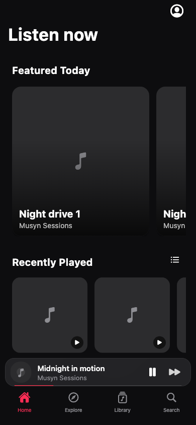
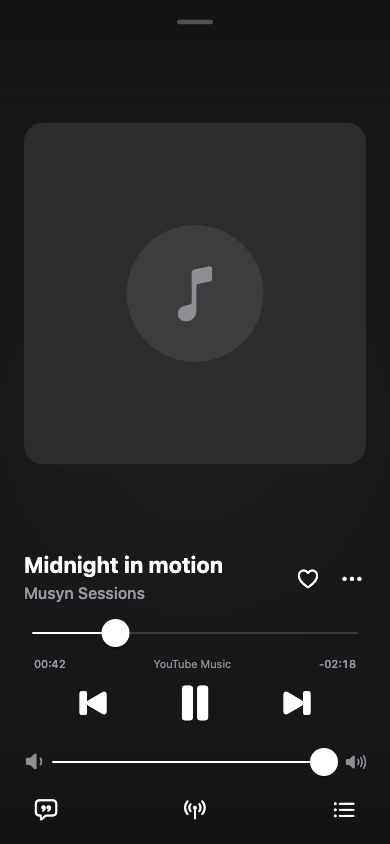
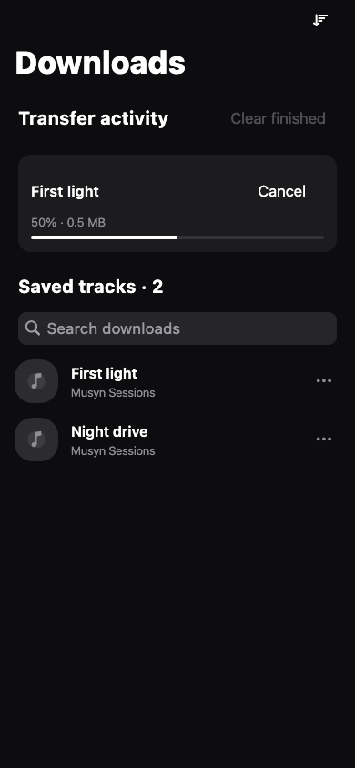

<p align="center"></p>
<h1 align="center">Musyn</h1>
<p align="center"><strong>Music, in your rhythm.</strong><br>An iPhone music player by <a href="https://voryn-labs.github.io/">Voryn Labs</a>.</p>
<p align="center">
<a href="https://github.com/Voryn-Labs/Musyn/releases/tag/v0.1.6"></a>
<a href="https://github.com/Voryn-Labs/Musyn/actions/workflows/build-ios.yml"></a>
<a href="https://github.com/Voryn-Labs/Musyn/releases"></a>

</p>
<p align="center"><a href="https://voryn-labs.github.io/musyn.html">Meet Musyn</a> · <a href="https://github.com/Voryn-Labs/Musyn/releases/download/v0.1.6/Musyn.ipa">Download unsigned IPA</a> · <a href="https://voryn-labs.github.io/source.json">Installer source</a> · <a href="https://voryn-labs.github.io/musyn-privacy.html">Privacy</a></p>

## A player that keeps the music in view

| Listen | Organize | Take it with you |
| --- | --- | --- |
| YouTube Music and JioSaavn AAC, with explicit source selection | Queue, favorites, folders and your own playlists | Offline tracks and playlist downloads |
| Synced lyrics and a focused full player | Home, moods/genres, search and actual chart playlists | Progress, cancellation, retry and saved-track search |
| Highest/balanced/data-saver YouTube options and JioSaavn 160/320 kbps | Optional YouTube Music account sync | Dark/light appearance and a branded launch experience |

AAC is compressed audio; 320 kbps is **not lossless**. Provider availability and catalogue results can vary. No addon integration is included.

## A look inside

<p></p>

These are automated Flutter renders with fictional sample tracks and placeholder artwork. They show layout, not a device playback test. [More previews](docs/ui-review/README.md).

## Install Musyn 0.1.6

The current release is **0.1.6 (7)**: [latest release](https://github.com/Voryn-Labs/Musyn/releases/latest).

Requires **iOS 15+**. Download `Musyn.ipa` and its SHA-256 checksum from the [0.1.6 release](https://github.com/Voryn-Labs/Musyn/releases/tag/v0.1.6). The IPA is **unsigned**. Use your own signing identity with a compatible installer, or import it into a compatible LiveContainer version. AltStore PAL cannot install this unsigned build. Installer and host restrictions still apply.

One Voryn Labs source for **Musyn and Cloudified**: `https://voryn-labs.github.io/source.json`. The maintainer refreshes the shared catalog manually after publishing new app releases.

Identity: `com.vorynlabs.musyn` · version `0.1.6 (7)` · publisher **Voryn Labs**. This is a fresh identity with no legacy migration. The download badge measures release asset requests, not unique users or installations.

## Build and contribute

```sh
flutter pub get
flutter analyze
flutter test
python3 scripts/verify_branding.py
flutter build ios --release --no-codesign
```

Pinned CI toolchain: Flutter 3.47.7 / Dart 3.13.5. iOS builds require full Xcode. Native dependencies use Swift Package Manager. GitHub Actions builds and verifies the IPA, generates its source feed from the actual binary, and publishes a regular release only when requested. Existing releases are never silently replaced. See [build/release notes](docs/BUILD.md), [flow map](UI-FLOW-MAP.md) and [verification](VERIFICATION.md).

Automated tests cover playback coordination and UI flows. Physical iPhone lock-screen playback, interruptions, real provider availability and installer behavior still require acceptance; no universal reliability claim is made.

## Credits and license

Maintained by **Voryn Labs** under [GPL-3.0](LICENSE). Developed from the Musified/Musify lineage; the interface work references BitChord. Upstream authors, vendored libraries and providers retain their credits and rights. [Full credits](docs/CREDITS.md). Music and artwork remain the property of their respective owners.
